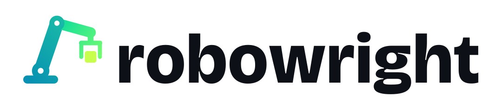
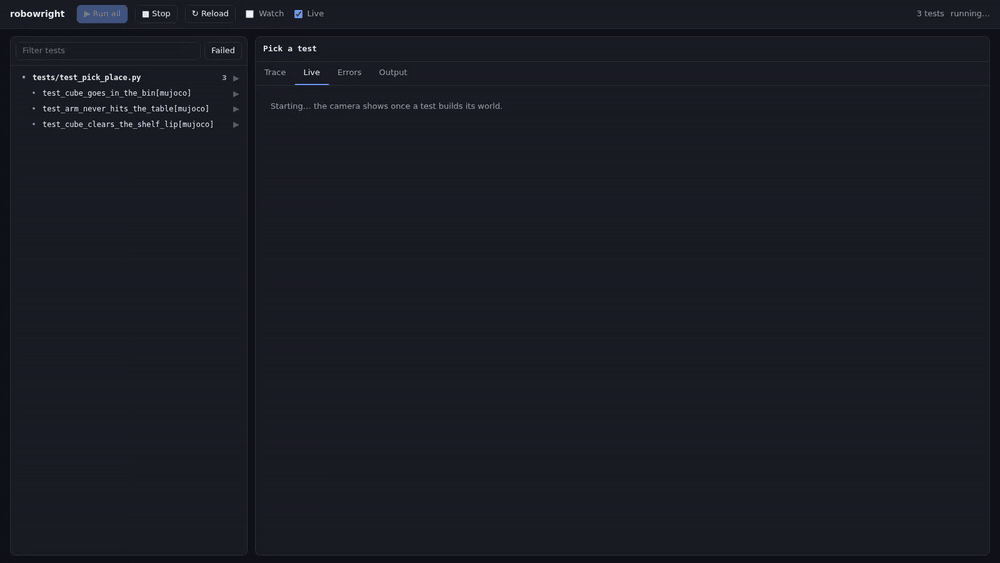
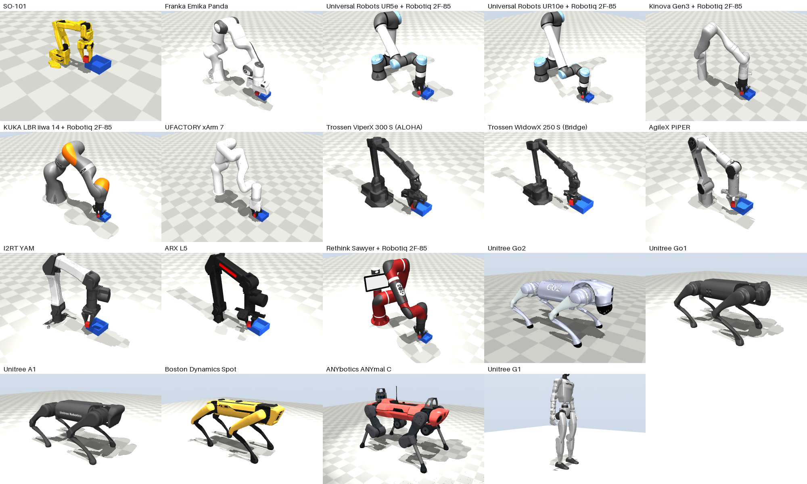
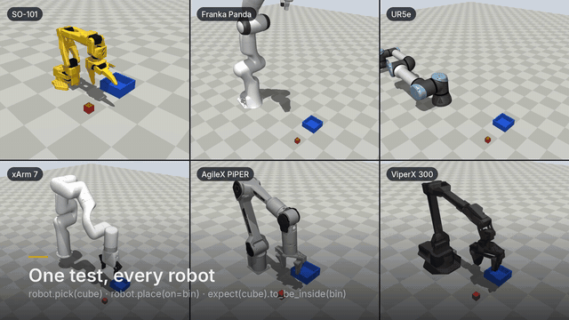
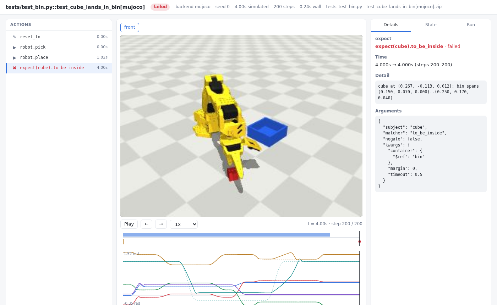

<p align="center">
  <picture>
    <source media="(prefers-color-scheme: dark)" srcset="docs/logo-dark.svg">
    
  </picture>
</p>

<h3 align="center">Playwright-style testing for robot software.<br>Your controller, policy or ROS 2 stack drives the robot. robowright watches, asserts and keeps the evidence.</h3>

<p align="center">
  <a href="https://github.com/JeremiahM37/robowright/actions/workflows/ci.yml"></a>
  
  <a href="LICENSE"></a>
  
  
</p>

<p align="center">
  <a href="#quickstart-60-seconds">Quickstart</a> &middot;
  <a href="#which-engine">Engines</a> &middot;
  <a href="#robots">Robots</a> &middot;
  <a href="#a-tour">Tour</a> &middot;
  <a href="#traces-replay-codegen">Traces</a> &middot;
  <a href="#troubleshooting">Troubleshooting</a> &middot;
  <a href="CONTRIBUTING.md">Contributing</a>
</p>

<p align="center"></p>
<p align="center"><sub><code>robowright test --ui</code>: run the suite and watch the arm, then open a failure's trace at the moment it failed.
Recorded by <a href="scripts/record_ui_demo.py"><code>scripts/record_ui_demo.py</code></a>.</sub></p>

In Playwright, your web app is what is under test and the browser is real. robowright works the
same way for robots: **your code drives the robot**, in a physics engine, in Gazebo or on the real
arm over ROS 2, and the test **only observes and asserts**. Assertions retry until the physical
world catches up; every failure leaves a **trace** you can scrub through, a bit-for-bit
**replay** and a generated **regression test**. Pre-alpha (see [Limitations](#limitations)).

## Quickstart (60 seconds)

You need [uv](https://docs.astral.sh/uv/) (or plain `pip`) and Python 3.10+. No GPU and no model
download: the default robot (SO-101) and engine (MuJoCo) ship with the package.

```bash
uv venv && source .venv/bin/activate
uv pip install "robowright @ git+https://github.com/JeremiahM37/robowright"   # or: pip install "git+https://github.com/JeremiahM37/robowright"
robowright info                                    # sanity check: versions, engines, offscreen rendering
```

### Test your controller or policy

A policy is anything that maps an observation to joint targets: a function, a class, or a
trained model (`LearnedPolicy` loads ONNX, TorchScript, LeRobot and other checkpoints). The test
hands the robot to it and judges the outcome:

```python
# test_my_controller.py
from robowright import condition, expect
from robowright.policies import ScriptedPickPlace as MyController  # stand-in: import yours


def test_my_controller_puts_the_cube_in_the_bin(robot, scene):
    done = condition(scene["cube"], "to_be_inside", scene["bin"])
    rollout = robot.run_policy(MyController(), until=done, hold=1.0, timeout=15)
    assert rollout.success, rollout
    expect(scene["cube"]).to_be_at_rest()
```

```bash
pytest test_my_controller.py --rw-trace on       # the SO-101 in MuJoCo: about a second
pytest test_my_controller.py --rw-live            # watch it live in a browser as it runs
pytest test_my_controller.py --rw-debug           # step through it, one action at a time
robowright test --watch test_my_controller.py     # run it again on every save
robowright test --ui                              # or pick and run tests in a browser, each with its trace
robowright show-trace robowright-traces/*.zip --no-open -o trace.html
```

The same file runs on other robots and engines (`--rw-robot panda,ur5e`, `--rw-backend
mujoco,drake`), and a policy is judged as a rate across randomized scenes with
`@pytest.mark.trials(20, min_success=0.9)`. A robot does not pass on every engine: the SO-101's
scripted pick-and-place passes on MuJoCo and not reliably on PyBullet, so this example fails there, and
[the matrix](#the-matrix-every-robot-on-every-engine) has every pair. Outside pytest, `import
robowright as rw` and `rw.launch()` give the same world to a plain script.

### Test your ROS 2 stack

robowright serves its simulation as a ROS 2 robot (`/joint_states`, `/clock`, TF for the objects,
`FollowJointTrajectory` and `GripperCommand` actions, the forward controller's topic), so the
stack you run on the real arm drives it unchanged. The test starts your stack and watches:

```python
def test_my_stack_puts_the_cube_in_the_bin(scene, ros2):
    with ros2.run("ros2 launch my_robot pick.launch.py use_sim_time:=true"):
        expect(scene["cube"]).to_be_inside(scene["bin"], timeout=60)
```

`robowright init --ros2 "ros2 launch my_robot sim.launch.py" --gazebo` sets up a project for your
own stack (settings naming it, pytest against ROS 2, an example test any `ros2_control` robot runs):
`pytest` then starts the stack once and runs every test against it (see below).

[`examples/ros2_stack/pick_node.py`](examples/ros2_stack/pick_node.py) is a stand-in stack (TF,
an IK library, the two actions) and [`tests/test_ros2_bridge.py`](tests/test_ros2_bridge.py)
tests it that way. `robowright sim --ros2 --live` serves a simulation on its own, for you or
an agent to drive by hand.

What your stack receives or sends on a topic can be changed on the way, as Playwright's
`page.route` changes what a page gets from the network. Does it stop when the lidar goes quiet,
or cope with late joint readings?

```python
with ros2.run(
    "ros2 launch my_robot nav.launch.py",
    route={
        "/scan": rw.route.cut(at=5.0, duration=2.0),  # quiet for 2 s of sim time
        "/joint_states": rw.route.delay(0.2) | rw.route.drop(0.05),
        "/cmd_vel": lambda msg: None if msg.linear.x > 0.5 else msg,  # your own edit; None drops it
    },
):
    expect(robot).always.to_have_no_collisions()
```

Every node the command starts has the topic remapped (a wrapping launch file for `ros2 launch`,
`--ros-args -r` for a node or script), and robowright relays it through the route: `abort()`,
`drop(p)` (seeded), `delay(s)`, `cut(at, duration)`, `throttle(hz)` or a function. Whether it
changes what your nodes read or what they send is found from the graph. `ros2.routes` and the
trace say what each route passed, dropped and delayed, and a route that changed nothing (no
such topic, or nodes that ignored the remapping) fails the test instead of passing it silently.

A topic can be recorded and played back, as Playwright records and replays network traffic in a
HAR file. `rw.route.record(path)` passes every message and writes it to a rosbag at its
simulated time; `rw.route.from_bag(path)` gives your nodes the bag's messages instead of the live
ones, at their recorded pace from when the command starts, with their header stamps set to the
time each arrives. A bag from `ros2 bag record` on the real robot plays the same way, so sensor
data recorded in the field can be the input of a test:

```python
with ros2.run("ros2 launch my_robot nav.launch.py", route={"/scan": rw.route.from_bag("field/scan_bag")}):
    expect(robot.base).to_be_near(goal, tol=0.3, timeout=60)
```

`from_bag(path, topic=..., at=..., loop=True)` picks one of several topics, starts later, or
starts over at the end.

The same routes work on a controller that is not behind ROS 2, on what it reads and what it sends:

```python
rollout = robot.run_policy(
    my_policy,
    until=done,
    route={
        "observation": rw.route.cut(at=2.0, duration=0.5),  # its sensors go quiet: it reads the last reading
        "action": rw.route.delay(0.05) | rw.route.drop(0.1),  # late, lossy commands: the last one stands
    },
)
``` `ros2.routes` counts what was played and what live messages it held back.

### Then the same tests against Gazebo or the real arm

`--rw-backend ros2` points the same tests at any robot behind ROS 2: a real arm with a
`ros2_control` driver, Gazebo through `gz_ros2_control`, or Isaac Sim's bridge. robowright
changes nothing in the robot; it reads joint states and TF, and sends commands only if the
test asks it to.

Name the stack and robowright starts it, once, as Playwright starts your web server:

```toml
[ros2]
use_sim_time = true
gazebo = true
[ros2.stack]
command = "ros2 launch ur_simulation_gz ur_sim_control.launch.py ur_type:=ur5e gazebo_gui:=false"
env = { DISPLAY = false }  # false unsets it: this launch gives gz sim no headless flag
```

`pytest --rw-backend ros2` then starts the stack once per worker, waits until it is up (read
from the ROS graph: joint states arriving, the controllers active and their spawners finished,
`/clock` moving), and before each test puts it back as it came up, as Playwright gives each
test a fresh browser context: models the last test added are removed, moved ones put back, and
each arm and gripper controller driven to where it started. The robot is the one the stack
describes. A stack a reset cannot put back (a controller that went inactive, a process that
died) is restarted, and the trace says so. Each `-n` worker gets a stack, a ROS domain and a
Gazebo partition of its own.

On Universal Robots' Gazebo simulation, four tests that each move the arm and add a cube take
22 s, 16 s of which is the stack starting once; each further test costs about 0.6 s of setup
(the reset, then connecting) plus its own motion. Starting a stack per test cost 8-12 s, and
stopping it 10 s more. In Python, the same is `rw.ros2_stack(command)` (`with` it in a session
fixture; `stack.reset()` per test; `stack.checkpoint()` makes the stack as it is now what a
reset returns to, such as a table spawned once).

A stack on simulation time can also run faster than real time: `speed = 4.0` in `[ros2.stack]`
(or `rw.ros2_stack(..., speed=4.0)`) sets Gazebo's real-time factor once it is up. Tests wait in
simulated time, so the same test takes less wall time; `ros2_control`'s controllers run inside
Gazebo's step and keep pace exactly, while nodes outside it (MoveIt, Nav2) follow the clock and
fall behind if the machine cannot keep up.

Before pointing a test at a real arm, give it limits. A command robowright plans itself
(`move_to`, `move_joints`, `reset_to`) is planned inside them however fast it was asked to go;
one it did not plan (a policy's target) that would break them is refused before any of it is
sent, with the joint and the value, and the arm holds where it is:

```toml
[ros2.limits]
joint_speed = 0.5                                  # rad/s, any arm joint
positions = { shoulder_lift_joint = [-2.0, -0.5] } # per joint, in the driver's names
```

[`tests/test_ur_driver.py`](tests/test_ur_driver.py) runs Universal Robots' own driver
(`ur_robot_driver`), exactly as on a real UR but with its mock hardware in place of the arm:
robowright finds the robot and UR's controller with no settings, drives it inside the limits,
and refuses a policy's jump. On the real arm the only change is `use_mock_hardware:=false` and
the robot's address.

An arm on USB, with no ROS: `backend="lerobot"` drives any arm LeRobot drives (SO-100/101, Koch,
OMX, ...) through LeRobot's own driver, made and calibrated as LeRobot's scripts make it.
robowright reads and sends LeRobot's `<motor>.pos` values (degrees, the gripper on 0..100),
moves nothing when the world opens, and keeps to limits that default to 1 rad/s:

```python
from lerobot.robots.so_follower import SOFollower, SOFollowerRobotConfig

arm = SOFollower(SOFollowerRobotConfig(port="/dev/ttyACM0", id="my_so101"))
w = rw.launch(backend="lerobot", robot="so101", lerobot=arm, limits={"joint_speed": 0.5})
w.robot.reset_to()  # slowly, to the home pose
w.robot.arm.move_to(w.robot.tcp.position + [0.0, 0.0, 0.03])
expect(w.robot.tcp).to_be_near(...)
```

If LeRobot's zero or direction for a joint differs from the model's, `calibration={"elbow_flex": (-1, 0.5)}`
maps it (sign, offset in radians). [`tests/test_lerobot_backend.py`](tests/test_lerobot_backend.py)
drives LeRobot's own `SOFollower`, with only its serial bus stood in for.

The whole stack can be someone else's. [`tests/test_moveit_gazebo.py`](tests/test_moveit_gazebo.py)
runs Universal Robots' own Gazebo simulation of a UR5e (`ur_simulation_gz`: UR's description,
`gz_ros2_control`, UR's `scaled_joint_trajectory_controller`) and MoveIt (`ur_moveit_config`).
The code under test is other projects' too, run as published: [pymoveit2](https://github.com/AndrejOrsula/pymoveit2)'s
`ex_pose_goal.py` asks `move_group` for poses, and UR's own `example_move.py` (from
`ur_robot_driver`) sends trajectories straight to UR's controller. robowright loads UR's
description as it is (no gripper added), watches on Gazebo's clock without sending a command,
and asserts where the arm ended up:

```python
ur = robots.load("ur_description/urdf/ur.urdf.xacro?ur_type=ur5e&name=ur", gripper=False, base_pos=(0, 0, 0))
w = rw.launch(
    SceneSpec(robot=ur.name, objects=[]), backend="ros2", command=False, frame="base_link", gripper={"interface": "none"}, use_sim_time=True
)
goal = ["-p", "position:=[0.4, 0.2, 0.4]", "-p", "quat_xyzw:=[1.0, 0.0, 0.0, 0.0]", "-p", "use_sim_time:=true"]
with subprocess.Popen(["python", "pymoveit2/examples/ex_pose_goal.py", "--ros-args", *goal]):  # your MoveIt code
    expect(w.robot.tcp).to_be_near((0.4, 0.2, 0.4), tol=0.002, timeout=45, hold=0.5)
```

A target 4 cm off fails the test even though MoveIt reports success, and robowright's model of
the arm agrees with the robot's own TF to under half a millimetre. Running it found problems
in every layer:

- **robowright:** the ROS clock read 0 until Gazebo's first `/clock`, so a test's timeout could
  expire before anything moved; every arm was assumed to have a gripper; a Gazebo step
  could return with the world still reported running (Gazebo unpauses it to step, and about a
  third of the time the message with the last step says so); a model just removed could come
  back from a pose message already in flight; and with DISPLAY set to an X server without GLX
  (a virtual one), MuJoCo picked GLX and every render failed (robowright now uses EGL there).
- **pymoveit2:** it reads the robot's URDF and SRDF from `move_group`'s parameters, and UR's
  MoveIt configuration hands them over on topics instead, so none of its examples could start
  ("Invalid response from 'move_group/get_parameters'"). Fixed in
  [`scripts/patches/`](scripts/patches/pymoveit2-robot-description-topics.patch) (applied by
  `scripts/ros2_env.sh`, with tests in pymoveit2's own suite).
- **The cell, as UR ships it:** MoveIt failed 14 to 18 of every 40 plans for the test's poses,
  each failure after its full 10 s. Every UR joint but the elbow is allowed two full turns, and
  the simulated cell has a floor 1 cm under the base. KDL, MoveIt's IK solver here, returned shoulder angles a turn away
  from the arm's, poses only reachable by swinging the upper arm through that floor, so no plan
  existed (40 of 40 plans to one such goal failed). A floor-mounted cell holds the shoulder lift
  above the floor, which UR's description takes as a joint-limits file; with it, no time-outs.
  Of the plans left, 2.5% (15 of 600) failed MoveIt's own check of the finished path (the
  forearm through the wrist), because OMPL checks motions at 0.5% of a joint space this large;
  checked at 0.05%, 600 of 600 plans were found. And MoveIt's floor (UR's) is 1 cm below
  Gazebo's, a centimetre MoveIt would move the arm through and Gazebo would not; pymoveit2's
  collision example adds Gazebo's to MoveIt's scene. Moves were also started before UR's launch
  had finished loading its controllers, and the controller manager skips the hardware while it
  loads one; the rig now waits for every spawner. These settings are in
  [`tests/ur_moveit_rig.py`](tests/ur_moveit_rig.py), through UR's, MoveIt's and pymoveit2's own
  parameters, with UR's packages otherwise as shipped.
- **ros2_control, in simulation:** now and then UR's controller aborted a move
  (`PATH_TOLERANCE_VIOLATED`): the arm stopped dead for a quarter of a second while the
  trajectory ran ahead of it. The controller manager, on sim time, gives controllers the time
  of its own ROS clock, which is the last `/clock` message it received (bridged from Gazebo by
  another process), and not the time of the step `gz_ros2_control` calls it for. When `/clock`
  arrives late, controller time stands still while Gazebo runs on, then jumps. Found with
  probes in the running Gazebo (every physics step had its hardware write; Gazebo never
  paused) and the controller's own commands; with the machine loaded, UR's own example was
  aborted 7 times in 60. Given the step's time instead
  ([`scripts/patches/`](scripts/patches/ros2_control-sim-time-argument.patch), built and
  preloaded by `scripts/ros2_env.sh` and the rig), 0 in 60, through `/clock` stalls of up to
  2.5 s. Reported upstream
  ([ros2_control#3683](https://github.com/ros-controls/ros2_control/issues/3683)), with the fix
  proposed in [#3684](https://github.com/ros-controls/ros2_control/pull/3684).

In Gazebo, robowright can also **drive the simulator**, the way Playwright drives a browser
(`[ros2] gazebo = true`, [`robowright.gazebo`](src/robowright/gazebo.py)): objects' positions are
Gazebo's own, the scene's objects are spawned into the world, `world.move_object` and the trials'
scene randomization move them there, it pauses Gazebo and steps it an exact number of physics
iterations, and screenshots are Gazebo's rendering from cameras it adds to the world.

### Meet a robot that is already running

A robot behind ROS 2 that you did not set up is like a website you did not write: robowright
asks it what it is. `robowright ros2 inspect` reads the stack's own description, its joints and
its controller manager, and prints the settings to connect with:

```console
$ robowright ros2 inspect
robot description: /robot_description (ur)
joint states: /joint_states (6 joints, 498 Hz): elbow_joint, shoulder_lift_joint, ...
controllers (/controller_manager):
  scaled_joint_trajectory_controller  ur_controllers/ScaledJointTrajectoryController  active  6 joints
  joint_state_broadcaster             joint_state_broadcaster/JointStateBroadcaster   active
clock: simulation time (/clock is published)
Gazebo: world empty

[ros2]
use_sim_time = true
arm = { controller = "scaled_joint_trajectory_controller", interface = "trajectory" }
gripper = { interface = "none" }
gazebo = true
```

A launch that names no robot and no controller finds both the same way: the robot is the
description its stack publishes, loaded as it is (its own gripper, or none), and the arm and
gripper controllers are the active ones that claim its joints.

```python
with rw.launch(backend="ros2", use_sim_time=True, gazebo=True) as world:  # UR's Gazebo simulation, nothing named
    world.robot.arm.move_to((0.4, 0.1, 0.3))  # one goal to UR's own trajectory controller
    expect(world.robot.tcp).to_be_near((0.4, 0.1, 0.3), tol=0.001)
```

A move robowright plans goes to a trajectory controller the way MoveIt's do: the whole
trajectory as one `FollowJointTrajectory` goal, inside the joint speed limits of the robot's
description, which the controller interpolates and holds to its own tolerances. A move it
refuses or gives up raises `ActionError` with the controller's reason
(`PATH_TOLERANCE_VIOLATED: ...`). A controller that is not there, or a command topic nothing
subscribes to, is an error when the world is launched, not a robot that silently does not move.

Stacks this is tested around, each as its makers ship it, on ROS 2 Jazzy:

| Stack | What runs | Code under test | robowright |
|---|---|---|---|
| Universal Robots UR5e ([`test_moveit_gazebo.py`](tests/test_moveit_gazebo.py)) | `ur_simulation_gz` (Gazebo, `gz_ros2_control`), `ur_moveit_config` | pymoveit2's examples, UR's `example_move.py` | observes; drives Gazebo; drives the arm through UR's controller |
| MoveIt's Panda demo ([`test_moveit_panda.py`](tests/test_moveit_panda.py)) | `moveit_resources_panda_moveit_config` (mock hardware) | pymoveit2's pose, joint and gripper examples | observes; drives arm and hand through the demo's controllers; finds them by itself |
| Kinova Gen3 + Robotiq 2F-85 ([`test_kinova_gazebo.py`](tests/test_kinova_gazebo.py)) | `ros2_kortex`'s `kortex_sim_control` (Gazebo) | robowright's own pick and place, through Kinova's controllers | drives arm and gripper; picks a cube and sets it in a bin, judged by Gazebo's poses |
| UFACTORY xArm 6 + xArm Gripper ([`test_xarm_gazebo.py`](tests/test_xarm_gazebo.py)) | `xarm_ros2`'s `xarm_gazebo` (Gazebo), with its mimic-joint plugin built from UFACTORY's source | robowright's own moves and pick, through UFACTORY's trajectory controllers | connects with nothing named, agrees with TF, reaches three goals and drives the gripper; the pick fails as published: the jaws close unevenly (32 mm on one side, 21 mm on the other) and kick the cube 4 to 8 cm. In 1 of 12 runs of the gripper test Gazebo itself crashed about 2 s after start, a segmentation fault inside the mimic-joint plugin: robowright stops with "the simulation clock has not moved", and the test records the crash as an expected failure only when Gazebo's log shows it |
| Franka FR3 ([`test_franka_gazebo.py`](tests/test_franka_gazebo.py)) | `franka_ros2`'s `franka_gazebo_bringup` (Gazebo), built from source with libfranka 0.20.5 | Franka's own example controllers (joint position, velocity, impedance) | observe only: the bringup loads no trajectory controller. Each example moves as its source says (position: 0.0393 rad about the ready pose, period 10.00 s; impedance: 0.400 rad against π/8); the TCP agrees with Franka's TF to 0.1 mm; the impedance example lets joint 2 move 0.06 rad where its source holds it |
| Nav2 with a TurtleBot 4 ([`test_nav2_examples.py`](tests/test_nav2_examples.py)) and a TurtleBot 3 ([`test_nav2_turtlebot.py`](tests/test_nav2_turtlebot.py)) | Nav2's own example launch files (Gazebo, AMCL, the navigation stack) | `nav2_simple_commander`'s `example_nav_to_pose` and `example_follow_path` | observes a mobile robot: where it is (Gazebo) against where Nav2 believes it is (TF) |

With `gazebo=True` robowright also reads what stands in the stack's world. Gazebo's static
models (a table, its legs, the ground) become fixtures: listed in the snapshot, and obstacles to
robowright's own moves. A joint move whose straight line would pass through one is planned round
it, or refused with the fixture's name; a grasp is planned above the surface the object rests on.
(The xArm stands on a table, and its first pick swept the hand through the table top: the
controller aborted, 1 rad behind.) Boxes, cylinders, spheres and planes are read; a mesh counts as
its bounding box, or is skipped and noted. Worlds with no static models behave as before.

A wheeled robot has `robot.base` in place of an arm: where it is, by Gazebo's ground truth, and
`robot.base.estimate`, where its own stack believes it is. Any topic and any TF frame can be
watched and asserted on:

```python
with rw.launch(
    backend="ros2", command=False, use_sim_time=True, gazebo=True, base={"frame": "base_footprint", "in": "map"}
) as world:  # Nav2 drives; robowright watches
    robot = world.robot
    expect(robot.base).always.to_be_upright(tol_deg=5)
    expect(world.ros.topic("/scan")).to_publish(hz=10.0, tol=0.25, timeout=10)  # the lidar, at its rate
    expect(robot.base.estimate).to_be_near(goal, tol=0.75, timeout=120)  # arrived, by Nav2's own belief
    assert np.linalg.norm(robot.base.estimate.position - in_map(robot.base.position)) < 0.5  # and the belief is true
```

It can be driven too, through what its own stack offers, found in the ROS graph like an arm's
controllers: velocity commands on its `cmd_vel` topic (`Twist` or `TwistStamped`), and goals to
its navigation stack where it has one.

```python
robot.base.drive(0.2, 0.0, 1.0)  # 0.2 m/s for 1 s: the TurtleBot 3 moves 0.178 m (it accelerates at 1 m/s^2)
robot.base.go_to((0.5, -0.5), yaw=0.0, timeout=90)  # a NavigateToPose goal to Nav2; aborted or refused raises ActionError
```

A test can also act on the graph directly, as Playwright's `request` fixture calls an API: no
client code, types from the graph, messages as dicts, and every wait in the world's time. Each
request is in the trace's timeline.

```python
listed = world.ros.call("/controller_manager/list_controllers")
r = world.ros.send_goal(
    "/arm_controller/follow_joint_trajectory",
    {"trajectory": {"joint_names": names, "points": [{"positions": target, "time_from_start": {"sec": 1}}]}},
)
assert r.ok  # r.status: "succeeded", "aborted", "canceled" or "rejected"; r.result
world.ros.publish("/initialpose", {"header": {"frame_id": "map"}, "pose": {"pose": {"position": {"x": 0.5}}}})
```

A goal or command on the arm's own controller takes the arm: robowright stops holding it (its
hold would replace your goal) and takes it back when it next moves the arm itself. `world.ros`
works on a world the `ros2` fixture serves too.

A test can also answer a service your stack calls, in place of the node that would, as Playwright's
`route.fulfill` answers a page's request: a perception service that sees what the test says, a
planner that fails on purpose, a driver's trigger. Each call is kept with its time, request and
answer:

```python
def detect(request):
    return {"success": True, "message": "cube at 0.22, -0.06"}


with world.ros.serve("/detect", "std_srvs/srv/Trigger", detect) as stub:
    with ros2.run("ros2 launch my_robot pick.launch.py"):
        expect(cube).to_be_inside(bin, timeout=30)
assert stub.count == 1
```

The answer can also be fixed (a response or a dict) or empty. An error raised while answering gives
the caller an empty response, so the stack does not hang, and is raised in the test when the stub
closes. A service something else already serves is refused, since a call could reach either.

An action is answered the same way. `world.ros.serve_action("/grasp",
"control_msgs/action/GripperCommand", result, outcome="aborted")` accepts each goal and finishes it
at once, succeeded or aborted (or as a function of the goal decides), with the result you give, so
the test watches how the stack handles a grasp that fails or a goal that is refused. Each goal is
kept in `stub.goals`.

A goal off the map is refused in Nav2's words (`ActionError: navigate_to_pose aborted:
GOAL_OUTSIDE_MAP`). A goal inside a wall is not: Nav2 plans to the nearest free space, stops
0.45 m short and answers SUCCEEDED, with a goal tolerance of 0.25 m. Its answer is not the
outcome, and `expect(robot.base).to_be_near(goal, tol=0.25)` fails as it should.

With Nav2's examples run as Nav2 launches them, the TurtleBot 4 arrives 0.17 m from
`example_nav_to_pose`'s final goal and 0.22 to 0.35 m from `example_follow_path`'s (Nav2's own
goal tolerance is 0.25 m, and the example reports success at 0.35), and Nav2's belief stays
within 0.26 m of where Gazebo has the robot.

A wheeled robot also runs in robowright's own MuJoCo simulation, from its model file. The wheels
are driven as wheels, on the floor, with the wheel radius and track measured from the model
(TurtleBot 3 burger: 0.033 m and 0.160 m, its published figures):

```python
# turtlebot3_description/urdf/turtlebot3_burger.urdf from github.com/ROBOTIS-GIT/turtlebot3. It is a
# xacro file: pip install "robowright[urdf]" (xacro and the mesh tools) to load it as it is.
world = rw.launch(robot="turtlebot3_burger.urdf")  # ROBOTIS's URDF, as published
robot = world.robot
robot.base.drive(0.2, 0.0, 2.0)  # 0.39 m travelled: it accelerates, and wheels slip
robot.base.go_to((1.0, 0.5), yaw=0.0, timeout=60)  # turn, drive, turn, on the true pose
expect(robot.base).to_be_near((1.0, 0.5, 0.0), tol=0.05, timeout=3)
```

Here `go_to` is a turn-drive-turn controller on the simulation's true pose: it plans no path and
avoids nothing, and raises when it does not arrive in time. Commanded against travelled, over
2 s: the TurtleBot 3 burger and waffle drive 98 to 101% of a straight line and turn 92 to 99% of
a pivot; the TurtleBot 4 drives 97 and 98%. (It drove 76 to 89% until its caster's friction was read from
its own file: the URDF gives the caster 0.1 in its Gazebo block, the converter dropped that, and
the caster dragged at the floor's 1.0.) A base with omni wheels whose rollers are modelled takes a
sideways speed, `drive(linear, angular, duration, lateral=...)`, with the wheel map measured from
the rollers, each wheel's lever for turning taken at the roller on the floor. On Menagerie's Robot
Soccer Kit it pivots 97% of the command on MuJoCo, 99% on Genesis and 100% on Drake, and drives
forward and sideways within 3% on Genesis and Drake. On MuJoCo, as published, it slips in a straight
line (58% forward, 42% sideways): the model gives each 3 g roller the wheel motors' armature, 10^5
times its own inertia, so a roller cannot spin up as it rolls onto the floor. `--rw-fidelity
adjusted` takes that off (recorded as the change "free rollers") and it drives 98% forward and 96%
sideways. `robowright.assets.diffdrive_mjcf()` is a minimal differential-drive base of our own,
for tests that need no particular robot: `rw.launch(robot=str(robowright.assets.diffdrive_mjcf()))`.

### Test in a simulation someone else built

Most robot-learning code runs in an environment its authors built: a Gymnasium, dm_control or
robosuite environment that owns its MuJoCo model, its scene, its action mapping and its step
loop. `rw.attach(env)` attaches to that simulation as it is. Nothing in it is changed, and time
passes when their code steps it. Attach before the first `env.reset`: a reset made earlier is not
in the trace, and the run then cannot be replayed or written as a test (replay says so). Gymnasium's
own MuJoCo environments need `pip install "gymnasium[mujoco]"`.

```python
env = gym.make("gym_aloha/AlohaTransferCube-v0", obs_type="pixels_agent_pos")
world = rw.attach(env)  # their MjModel and MjData, found in the environment
obs, _ = env.reset(seed=1)
cube = world.body("box")  # any body, site, geom or joint, by its name in their model
expect(cube).always.to_be_above(-0.01)  # checked on every env.step
for _ in range(400):
    obs, *_ = env.step(policy(obs))  # their loop, their policy
expect(cube).to_be_touching("vx300s_left/10_left_gripper_finger")
expect(cube).not_.to_be_touching("table")  # the outcome, from the simulation's own contacts
world.close()  # a trace of the episode, redrawn from their model
```

Give it `advance=lambda: env.step(policy(obs))` and `expect(...)` waits by stepping their
environment, as it waits everywhere else. `world.move_object` and `world.push` disturb their
simulation, recorded in the trace.

[`examples/published_policy`](examples/published_policy/test_act_aloha.py) runs LeRobot's
published ACT checkpoint (`lerobot/act_aloha_sim_transfer_cube_human`, from camera images) in
gym-aloha with LeRobot's own pre- and post-processing. robowright's reading of the contacts
agrees with the environment's `is_success` on every seed: four of five seeds hand the cube over,
and on seed 0 the right gripper lifts the cube to 29 cm and drops it before the left one has
touched it, the same way in every run (registered as a strict expected failure, with that
measurement). [`examples/environments`](examples/environments) attaches the same way to:

| Suite | Code under test | Result |
|---|---|---|
| Meta-World 3.1 | its own scripted expert policies (pick-place, drawer, button, door) | robowright's reading of the object and the environment's success flag agree on 5 of 5 seeds for three tasks; door-open's flag is false at the end with the door open 1.85 rad (registered) |
| Gymnasium-Robotics 1.4 | none ships: a reach written in the test | FetchReach agrees with `is_success` 5 of 5; Fetch pick-and-place, Franka Kitchen and the Shadow hand attach |
| dm_control 1.0 | none ships: a reach written in the test | reacher agrees with the task's reward 5 of 5; walker and a manipulation task attach |
| robosuite 1.5 | none ships | Lift attaches; robosuite builds a new model on every reset, which robowright follows |
| ManiSkill 3 (SAPIEN) | its own motion-planning solutions (pick, stack, push) | agrees with the environment's `success` on 15 of 15; with the cube moved 3 cm after reset, pick and push still succeed 5 of 5 and stack 4 of 5 |
| panda-gym 3 (PyBullet) | none ships: a reach written in the test | PandaReach agrees with `is_success` 5 of 5; pick-and-place attaches |
| gym-pybullet-drones (PyBullet) | its own `DSLPIDControl` | the drone hovers 5.4 mm from its target, and robowright's reading agrees with the environment's state to 1 mm |
| Drake 1.57 (MultibodyPlant) | none ships an arm in this install: Drake's own table, block and Acrobot models | the block rests on the table with a contact force equal to its weight, and a 0.5 N push slides it 14 cm |
| Genesis 1.4 (CPU) | none: the package's own Franka scene from its `play()` demo, plus a box | the box rests with a contact force equal to its weight, and a 6 N push moves it 16 mm |
| Webots R2025a | its own `ure_can_grasper` controller, in its shipped `ure.wbt` world (UR3e arms picking cans off a conveyor) | while their controller runs, the gripper reaches its grasp point and the can is lifted above 1.0 m, within 25 s, on 6 of 6 runs |

Attach reads MuJoCo, PyBullet, SAPIEN, Drake, Genesis and Webots simulations through one small adapter each
([`attached_engine.py`](src/robowright/backends/attached_engine.py) is the contract for another).
A MuJoCo trace is redrawn frame by frame from their model; the other engines' traces keep
every body's pose and say that they cannot be redrawn. A Drake `Simulator` cannot be wrapped, so
a loop around one steps through `world.step()` or calls `world.observe()`; Drake's hydroelastic
contacts are not read. Webots runs as its own process: `rw.attach(env, engine="webots")` reads a
world through a Supervisor robot with an `<extern>` controller added to it (poses and the clock;
no contacts, joints, pushes or moved objects), and the test names the nodes it watches with `DEF`
names. Headless, Webots still needs an X display (Xvfb) and `libGLU`. Holding is judged by force, not by a
contact existing: SAPIEN keeps zero-force contacts after a gripper lets go, which first read as
"still held" on every seed. These suites pin different versions of their engines, so each runs
in its own environment; the examples skip where a suite is not installed.

A trace of an attached MuJoCo run keeps what made the environment (its gymnasium id, keyword
arguments and episode limit), every reset and action, and the calls the test made. `robowright
replay trace.zip` runs it again and compares the state at every step (a Fetch pick-and-place run
of 80 steps replays bit-identical), and `robowright codegen trace.zip -o test_run.py` writes it as
a test, with a long run's actions in a file beside it. An environment built by hand has no id to
record: its test is written with a `make_env()` for you to fill in, and says so. Replay compares
states and does not check expectations again. PyBullet (panda-gym) and SAPIEN (ManiSkill 3) runs
replay and become tests too: those engines save no full state, so every body's pose is recorded
and compared at every step, and the result is reported as within a tolerance (1e-6 m or rad), not
as identical. Measured on one seed each (panda-gym pick-and-place, 300 steps; ManiSkill PickCube,
120 steps), fresh-process replays differed by zero, and a changed action was caught one step later.

A Drake or Genesis run has no gymnasium id, so it replays from Python with a factory that builds
the simulation again: `replay(trace, make_env=build)`, where `build()` returns the Drake
`Simulator` (or `(simulator, plant)`) or the built Genesis scene. Replay steps it on the recorded
clock and repeats the resets, moves, joint edits and pushes of the run. What your own code set
between steps (actuation inputs, controllers outside the diagram, joint targets) is not in the
trace: the factory has to build the same ones, or the replay diverges and reports where. Measured
on small scenes (a block on a table, 180 to 230 steps): replays differed by zero on both engines,
a block started 5 cm higher was caught at step 0, and a changed block mass on Drake at step 9. On
the command line the factory is named: `robowright replay trace.zip --factory my_module:build`
(or `path/to/file.py:build`), and `robowright codegen trace.zip --factory my_module:build -o
test_run.py` writes the run as a test that steps the simulation, repeats the pushes and moves and
checks the run's expectations at the steps they were made (without `--factory` the test has a
marked stub to fill in). A test generated from a failing Drake or Genesis run fails at the same
expectation. A Webots run replays the same way, the factory starting the world: three fresh runs
of a UR arm world with its controller (1875 steps) agreed with each other to zero, and a 300-step
recording replayed with zero error. Webots replays once per process (a controller connects once),
and Webots runs are not written as tests.

A Gazebo world needs no ROS to be attached to: `world = rw.attach(engine="gazebo")` (or
`world_name="..."`) reads a running `gz sim` over Gazebo's own transport. Models and links are
subjects with ground-truth poses, joints are read from the world's `JointStatePublisher` system
(without it, asking for a joint says which system to load), and time is the world's clock. A paused
world is stepped by robowright (100 steps advanced the clock by exactly 0.1000 s, about 17 ms of
wall time per step); a running one is observed as it runs. Tested on two worlds Gazebo ships
(`lift_drag.sdf`, `diff_drive.sdf`): a joint under constant torque turned four times as far in
twice the steps (measured 3.977), and an invariant on its angle fired at the step it was crossed.
Pushing, moving things, contacts and saving state are refused there, by name; in a running world
poses and joints arrive on separate streams and are not from the same step.

A vector environment is attached whole: `worlds = rw.attach(vec_env)` for a `SyncVectorEnv`
(`gymnasium.make_vec(..., vectorization_mode="sync")`), and `worlds[i]` is an ordinary world for
sub-environment `i`, with its own subjects, expectations, invariants and trace, checked on the
vector env's own `step`. An invariant broken in one sub-environment is reported with its index, and
an autoreset inside `step` is recorded as a reset on that index's trace. With 8 HalfCheetah
sub-environments attaching costs 0.02 ms per vector step with traces off and 0.14 ms with them on
(0.20 ms unattached).

An `AsyncVectorEnv` runs its sub-environments in worker processes. robowright reaches them the way
Playwright reaches a browser: from outside, through a wrapper in each worker that answers for that
worker's own engine. Make the vector env with it, then attach as before:

```python
vec = gymnasium.make_vec("HalfCheetah-v5", 8, vectorization_mode="async", wrappers=[rw.attachable])
worlds = rw.attach(vec)  # worlds[i]: sub-environment i, read in its worker
```

Everything above holds unchanged: subjects, expectations, invariants with the index, pushes (applied
inside the worker, to that index only), autoresets and traces. Each index reads exactly what the same
index of a `SyncVectorEnv` reads, step for step (MuJoCo and PyBullet, under `fork`, `spawn` and
`forkserver`). Reads are fetched once per vector step for every index in one round trip: with 8
HalfCheetah workers, 0.25 ms per vector step with traces off and 0.38 ms with them on (0.12 ms
unattached). A vector env made without the wrapper is refused, saying how to add it, and its workers
keep running.

Stable-Baselines3's vector envs attach the same way: a `DummyVecEnv` like a `SyncVectorEnv`, and a
`SubprocVecEnv` through `rw.attachable` in its workers
(`make_vec_env(..., vec_env_cls=SubprocVecEnv, wrapper_class=rw.attachable)`), through `VecNormalize`
and other wrappers. A `SubprocVecEnv` index reads exactly what the same `DummyVecEnv` index reads, and
the reset Stable-Baselines3 makes inside the step that ended an episode is on that index's trace, which
replays. Each sub-environment's trace replays and is written as a test like any other attached run,
autoresets included (the same state at every step over three sub-environments, in both of gymnasium's
autoreset modes, from either vector env). The first reset must be given a seed
(`vec.reset(seed=0)`): gymnasium seeds an unseeded environment from the operating system, so such a
run cannot be repeated, and `replay` and `codegen` refuse its trace and say so. The same holds for a
single gymnasium environment.

### What a passing test tells you

A pass in simulation says: *this code did this task on this robot model in this engine.* It
does not say the real arm will. robowright keeps that gap visible instead of tuning it away:

- **The robot is its model file as published** (`--rw-fidelity published`, the default), plus
  only values with a cited source, such as a gripper's rated force from its datasheet. Every
  other change robowright makes is recorded in the run, by kind: a **repair** the file needs
  to simulate at all, the **interface** robowright drives it through (one rule for every robot),
  or a translation for another engine. `robowright fidelity --robot panda --backend drake` lists
  them, and every trace and report carries them.
- **robowright's own tuning is opt-in.** `--rw-fidelity adjusted` adds what it once used to make
  more tests pass: stiffer contacts, capped grippers, stiffened servos, an integral term under a
  policy's commands. More robots pass with it, on physics nobody measured.
- **Engines disagree, and that is information.** `--rw-backend mujoco,drake` and `robowright
  crosscheck` run the same test on another contact model; where only one engine passes, the
  result depends on the engine, not on your code. Where an engine or a published model cannot
  do a task, the [registry of known divergences](conftest.py) says why, measured.
- **Some interfaces are kinder than real hardware.** Every simulated arm's weight is cancelled,
  as industrial controllers do; hobby-servo arms (the SO-101, Koch) do not do that.
- **Hardware is the ground truth.** `--rw-backend ros2` runs the same test on the real arm. So
  far that has been tested against `ros2_control` on mock hardware, against robowright's own
  simulation behind ROS 2, and against Gazebo, but not yet on a physical robot.

### robowright's own controller

`robot.pick(cube)` and `robot.place(on=bin)` are robowright's reference controller: they wait
for the arm to settle, plan around the table and check the grasp. Use them to set up a
situation (hand an object to the robot, move it somewhere) or to try a robot model out; a test
that only calls them tests robowright, not your code.

```python
from robowright import expect


def test_the_reference_controller_on_every_robot(robot, scene):
    cube, bin = scene["cube"], scene["bin"]
    robot.pick(cube)
    expect(robot.gripper).to_be_holding(cube)
    robot.place(on=bin)
    expect(cube).to_be_inside(bin)
```

<p align="center"></p>

The same test runs unchanged on a Franka Panda, a UR5e with a Robotiq gripper, a Kinova
Gen3, a KUKA iiwa, an xArm 7, ALOHA's ViperX, the Bridge WidowX, a PiPER, a YAM, an ARX L5,
a Sawyer and the LeRobot SO-101, and on any other arm from its model file (MJCF, URDF or
xacro: `--rw-robot path/to/arm.urdf`): robowright works out which joints are the arm, which
parts are the fingers, how the gripper opens and where to mount it, from the model itself.
See [Any robot, from its model file](#any-robot-from-its-model-file).

<p align="center"></p>

For a whole project, `robowright init` writes an example test, `pytest.ini`, `robowright.toml`, a
GitHub Actions workflow and `.mcp.json` (so AI coding agents get the robot tools; it names the
Python that ran `init`, so it works with the environment not activated, and is this machine's), and
`pytest --rw-report report.html` gives the run as one HTML page.


## Why

Most robot software is tested by running it and watching. The tools that exist each cover
one slice of the problem:

- `launch_testing` checks that processes start and exit.
- Benchmark suites such as LIBERO and ManiSkill score policies on fixed tasks.
- Rerun and Foxglove record and visualise runs, but have no notion of pass or fail.

None of them gives you what web developers have had for years: a test that says what
should happen, waits for it, fails with a clear explanation, and leaves behind enough
evidence to debug it. robowright brings that workflow to robots (Playwright Test's features one by one, with
what is partial or missing, are in [Coming from Playwright](docs/playwright.md)):

| Playwright | robowright |
|---|---|
| your app is under test, in a real browser | your controller, policy (`robot.run_policy`) or ROS 2 stack (the `ros2` fixture) drives the robot, in an engine, in Gazebo or on the arm (`--rw-backend ros2`) |
| auto-waiting actions | `robot.arm.move_to(...)` returns only once the arm has settled; `gripper.close()` returns once the jaws have stalled |
| web-first assertions | `expect(cube).to_be_inside(bin)` re-checks every control step until it holds or times out, in *simulated* time |
| locators | `scene["cube"]`, `scene.get(color="red")`, `scene.nearest(to=robot.tcp)` are live handles, not snapshots |
| trace viewer | every failure leaves a `.zip` trace with joints, object poses, contacts and the action timeline, viewable as HTML with camera views drawn from it, and a Source tab at the line of your test each action came from |
| codegen | `robowright codegen trace.zip` rebuilds the exact failing situation as a pytest test; `robowright codegen --robot panda` writes one from what you do in a browser page |
| projects (browsers) | `--rw-backend mujoco,drake` and `--rw-robot panda,ur5e` run every test on each engine and robot |
| `npm init playwright` | `robowright init`: an example test, settings, a CI workflow, and the MCP server registered for AI agents |
| HTML reporter, `show-report` | `pytest --rw-report report.html`: every test, each failure with its trace as text and in the viewer; `robowright show-report` opens it (`--port 0` serves it, for a report on CI or another machine) |
| `toHaveScreenshot` | `expect(world).to_match_snapshot("tidy.png")`: a camera's view against an image kept beside the test, per engine and robot; `--rw-update-snapshots` writes them again |
| `toMatchAriaSnapshot` | `expect(world).to_match_state_snapshot("tidy")`: object positions, joints and a mobile robot's base, against text kept beside the test, each within a tolerance; delete a line to stop checking it |
| `expect.poll`, `toPass` | `expect.poll(lambda: node.state).to_equal("DONE")` waits on a value of yours, and `expect(block).to_pass()` retries a block of expectations, both in simulated time |
| `expect.extend` (custom matchers) | `expect.extend(to_be_level=fn)`: `fn(subject, ...)` returns `(passed, detail)`; the matcher then retries every control step, takes `timeout`/`hold`, `.not_`, `.always`, `expect.soft`, `expect.poll` and `condition()`, and shows in the trace and the debugger |
| `test.step` | `with rw.step("put the cube in the bin"):` names a part of a test: the trace and the viewer show what ran inside it, nested, and an error raised in it says `in step 'put the cube in the bin > check it landed'` |
| `webServer`, browser contexts | `[ros2] stack = "ros2 launch ..."`: the ROS 2 / Gazebo stack started once per worker and put back before each test in about half a second (`rw.ros2_stack` in Python) |
| `route.fulfill` for an API | `world.ros.serve("/detect", "std_srvs/srv/Trigger", answer)` and `world.ros.serve_action(...)`: the test answers a service or an action your stack calls, each call kept |
| `request` fixture (API calls) | `world.ros.call(service)`, `world.ros.send_goal(action, {...})`, `world.ros.publish(topic, {...})`: act on the ROS graph from the test, types found, messages as dicts, waits in sim time |
| `page.route` | `ros2.run(cmd, route={"/scan": rw.route.cut(at=5.0, duration=2.0)})`: what your stack receives or sends on a topic dropped, delayed, cut, throttled or edited on the way, in sim time |
| trace network log, console | a trace of a ROS 2 run keeps every topic's publishers, readers, message counts over time and last message (the viewer's Topics tab), and every node's log lines at their simulated time (its Log tab) |
| `recordHar`, `routeFromHAR` | `rw.route.record("scan_bag")` writes a topic to a rosbag as it passes; `rw.route.from_bag("scan_bag")` plays it to your stack instead of the live topic, at its recorded pace (a bag from `ros2 bag record` on the real robot too) |
| `testInfo.attach` | the `rw_attach` fixture: `rw_attach("stack.log", path=log)`, `rw_attach("notes.txt", text)`, `rw_attach.camera(world)`; images show in the HTML report, other files are linked |
| test timeout | `pytest --rw-timeout 120` (or `@pytest.mark.rw_timeout(300)` on one test): a test that runs longer fails, fixtures included (a ROS stack that never comes up), saying what was running when time ran out and where its other threads were, and keeps its trace; a test stuck inside a C call (where Python cannot see the limit pass) ends the run a minute later, every thread's stack left in `hung-<test>.txt` |
| `--shard 2/4` | `pytest --rw-shard 2/4`: the second of four parts of the suite, for a CI matrix; every test is in exactly one part, the same one on every machine |
| blob reporter, `merge-reports` | `pytest --rw-shard 2/4 --rw-blob shard-2.zip` on each machine, then `robowright merge-reports shard-*.zip -o report.html`: one report of the whole run, each failure's trace carried inside its shard's zip |
| retries, `trace: 'on-first-retry'` | `pytest --rw-retries 2 --rw-trace on-first-retry`: a failed test runs again in a fresh world; one that then passes is reported *flaky*, with the failed attempt's trace kept |
| `test.only`, `forbidOnly`, `globalTimeout` | `@pytest.mark.only`; `--rw-forbid-only` (on by itself when `CI` is set); `--rw-global-timeout 3600` |
| `expect.configure` | `expect.configure(timeout=10, soft=True)`: an `expect` with its own defaults |
| `--repeat-each`, `--fail-on-flaky-tests` | `pytest --rw-repeat-each 10`, `pytest --rw-fail-on-flaky` |
| `github` reporter | on a GitHub Actions runner, each failed test is an error annotation at the line of your test that failed (the trace's `show-trace` command in it), each flaky one a warning, on the pull request's diff; `--rw-github off` to stop it, `on` to see them anywhere |
| `--only-changed` | `pytest --rw-only-changed` (or `=main`): only the test files your uncommitted changes (or changes since `main`) can affect: changed tests, and tests importing a changed module, followed through the project's imports; a changed `conftest.py`, plugin, setting or robot model file runs everything |
| `video: 'on' / 'retain-on-failure'` | `pytest --rw-video retain-on-failure` (or `on`): each failed test's run as an MP4 beside its trace, drawn from the trace after the test, and played in the HTML report (needs `robowright[video]`) |
| `--debug`, `page.pause()`, Inspector | `pytest --rw-debug`: each test held before its first action in the live view, with what runs next and its line; Step, Resume, Pause. `world.pause()` stops a test there (not on CI) |
| `--headed` | `pytest --rw-live`: watch each test live in a browser (camera, joints, contacts, the current action); `--rw-headed`: MuJoCo's own window |
| UI mode (`--ui`) | `robowright test --ui` (any pytest arguments): the suite by file in a browser; run everything, a file or one test with a click and see each result as it comes; every test's trace opens in place, the camera can be watched live as a test runs, and Watch runs again on every save |
| watch mode | `robowright test --watch` (any pytest arguments): runs again on every save, only the changed test files when only tests changed and everything when your code, a robot model or the settings did; Enter runs everything |
| VS Code extension | [`editors/vscode`](editors/vscode): robowright's tests in the Test Explorer, run all, a file or one test; a failure on its line with a **Show trace** link that opens the trace viewer in a tab; a *Run with live view* profile; *Open the UI* |
| Playwright MCP, test agents | `robowright mcp`: an agent runs your policy or starts your ROS 2 stack against a robot, watches, asserts, saves a test, runs the suite and reads each failure's trace; `robowright init-agents` writes Claude Code agents that plan tests, write them from the plan, and heal failing ones (fixing a test that is wrong, marking a real failure as a strict xfail with what it measured, never weakening an assertion) |

On top of that, it adds things robots need and web pages don't:

- **Statistical tests:** a policy that works 92% of the time is normal. `@pytest.mark.trials(20, min_success=0.9)` runs 20 differently randomized scenes and judges the rate, with confidence intervals.
- **Fault injection:** sensor noise, command latency, weak servos, shoves and camera dropout, all seeded.
- **Invariants:** `expect(robot).always.to_have_no_collisions()` is checked after every step.
- **Deterministic replay:** re-simulates a trace from its recorded motor commands and reports the first step where anything diverges.

## Robots

| name | robot | maker | kind | joints | model licence |
|---|---|---|---|---|---|
| `so101` | SO-101 | TheRobotStudio / Hugging Face | arm | 5 | Apache-2.0 |
| `panda` | Franka Emika Panda | Franka Robotics | arm | 7 | Apache-2.0 |
| `ur5e` | Universal Robots UR5e + Robotiq 2F-85 | Universal Robots | arm | 6 | BSD (arm, gripper) |
| `ur10e` | Universal Robots UR10e + Robotiq 2F-85 | Universal Robots | arm | 6 | BSD (arm, gripper) |
| `gen3` | Kinova Gen3 + Robotiq 2F-85 | Kinova | arm | 7 | BSD (arm, gripper) |
| `iiwa14` | KUKA LBR iiwa 14 + Robotiq 2F-85 | KUKA | arm | 7 | BSD-3-Clause (arm), BSD (gripper) |
| `xarm7` | UFACTORY xArm 7 | UFACTORY | arm | 7 | BSD |
| `vx300s` | Trossen ViperX 300 S (ALOHA) | Trossen Robotics | arm | 6 | BSD |
| `wx250s` | Trossen WidowX 250 S (Bridge) | Trossen Robotics | arm | 6 | BSD |
| `piper` | AgileX PiPER | AgileX Robotics | arm | 6 | MIT |
| `yam` | I2RT YAM | I2RT | arm | 6 | MIT |
| `arx_l5` | ARX L5 | ARX | arm | 6 | BSD-3-Clause |
| `sawyer` | Rethink Sawyer + Robotiq 2F-85 | Rethink Robotics | arm | 7 | Apache-2.0 (arm), BSD (gripper) |
| `go2` | Unitree Go2 | Unitree Robotics | quadruped | 12 | BSD |
| `go1` | Unitree Go1 | Unitree Robotics | quadruped | 12 | BSD-3-Clause |
| `a1` | Unitree A1 | Unitree Robotics | quadruped | 12 | BSD-3-Clause |
| `spot` | Boston Dynamics Spot | Boston Dynamics | quadruped | 12 | BSD-3-Clause |
| `anymal_c` | ANYbotics ANYmal C | ANYbotics | quadruped | 12 | BSD |
| `g1` | Unitree G1 | Unitree Robotics | humanoid | 29 | BSD |

```console
$ robowright robots                              # this list
$ pytest --rw-robot panda,ur5e                   # pick robots
$ pytest --rw-robot all                          # every arm
$ pytest --rw-robot legged                       # every legged robot
```

### Any robot, from its model file

The robots above are not special: point `--rw-robot` at any arm's model file, MJCF or URDF, and
the same tests run on it.

```console
$ robowright robots --inspect path/to/my_arm.urdf   # what robowright makes of it, and why
$ pytest --rw-robot path/to/my_arm.urdf             # every robot test, on that robot
```

A model file describes every robot the same way (bodies, joints, actuators), but not what the
parts are for. robowright reads that off the model, the way Playwright finds a button by its
role:

- **The gripper** is the actuator that moves several coupled joints, a slide, or parts named
  like a gripper, at the end of the chain. Its **hand** is the body its joints hang from, and the
  **arm** is every actuated joint between the base and the hand.
- **The fingers** are the two moving parts that reach furthest along the tool axis and close
  towards each other, or one moving jaw against the hand (SO-100, SO-101, Koch). **Open** is
  whichever end of the gripper's range leaves them further apart.
- **Mounting:** the arm is placed (and turned, if its model faces another way) where top-down
  grasps reach the whole task area, with no part of its base standing where objects go or
  within 4 cm of a cube, where an open gripper comes down beside it. An arm whose zero pose lies
  in the table starts in its home pose instead.
- **Home, and every top-down reach,** is the IK solution nearest the arm's pose that keeps the
  hand out of the arm and its base. A redundant or unlimited arm can reach a point folded into
  itself (the e.DO's first home put its gripper 1 cm into its forearm, the wrist servo pushing
  at its limit); then robowright looks from other starting poses for one that does not.
- **A bare arm** gets a Robotiq 2F-85 on its flange, facing along the last joint's axis. A
  model with no site there gets it at the last link.
- **A mobile manipulator** (a free-floating base with a gripper and no legs, such as TIAGo) has
  its base held where it stands, and its arm is tested as on a fixed one. If its arm cannot
  reach the task area from anywhere that way (Stretch reaches along one line), its base drives
  instead: a joint forward and one turning in place. IK moves them a tenth as readily as the
  arm's joints, so the arm reaches first and the base drives for the rest.
- **An arm with no wrist roll** (four joints, say) grips at whatever angle it reaches with.
- **Joints that move together** (Stretch's telescope: four slides kept in step by the model's
  constraints, driven through one tendon) are one arm joint; its partners move with it, on
  every engine: a coupler constraint in Drake, a mimic joint in Genesis and Isaac Sim, a motor
  per segment in PyBullet (where geared, nested segments shuffled against each other).
- **A hand with several fingers**, each with motors of its own at the base and the tip (the
  three-finger Kinova Jaco), closes as one: every finger joint follows one finger's base joint,
  through a nearly rigid constraint. (MuJoCo's default softness scales with the mass it moves:
  on light fingers the first finger swept the cube away ahead of the others.)
- **Models that need adapting:**
  - fingers with a motor each are made to follow one, which gets their force together;
  - a force-motor gripper becomes a position servo;
  - an Euler-integrated model whose servos would oscillate runs `implicitfast`;
  - a force-limited joint too light to integrate stably gets the motor inertia the model left out;
  - a model on MuJoCo's default friction (a pyramidal cone, impratio 1), under which a held
    object creeps out of the fingers, gets the elliptic cone and impratio 10 that MuJoCo's own
    gripper models use;
  - a gripper whose fingers stop on each other well short of its closed command (Stretch's tips
    meet a seventh of the way along) reads closed where they meet;
  - a lift or telescope whose servo the joint's dry friction could stall more than 1 mm from a
    target (Stretch's lift: 4 mm) is stiffened to stall within 1 mm.

**URDF** is read with MuJoCo's own URDF reader, plus what it cannot do on its own:

- `package://` mesh paths are found the way ROS finds them: `ROS_PACKAGE_PATH`, then the
  directories around the file.
- COLLADA meshes are converted to OBJ.
- A URDF names no motors, so each joint gets a position servo that reaches its `effort` limit
  0.02 rad (2 mm on a slide) from its target. Where the file gives no effort, or an obvious
  placeholder (1000 N m on a hobby servo), the effort is twice what holding up and accelerating
  the arm and 1.5 kg needs. Geared joints get the motor inertia their stiffness needs to
  integrate stably.
- `<mimic>` joints follow their leader. The links collide with the world but not with each
  other, as PyBullet treats a URDF.
- Every engine collides a mesh as its convex hull. Where a gripper mesh's hull would fill the
  space between the jaws (an L-shaped fixed jaw), that mesh is split into convex parts with
  CoACD. A finger whose inner face is a pocket for a rubber pad keeps its hull, which stands in
  for the pad.

**xacro** templates are expanded on the way in, `$(find pkg)` resolved like `package://`. Their
arguments follow the path after a `?`, or go in `xacro_args`:

```console
$ pytest --rw-robot "ur_description/urdf/ur.urdf.xacro?ur_type=ur5e&name=ur5e"
```

`pip install -e ".[urdf]"` brings the tools (trimesh, pycollada, CoACD, xacro). Without them,
COLLADA visuals are left out and concave jaws stay hulls, both with a warning, and a xacro file
is refused with how to expand it by hand.

The arm is mounted, and its home chosen, where no link presses into the floor, checked with the
engine's own contacts (a bounding-box check passed ROBOTIS's OMY with its shoulder 3 mm into the
floor, and 9 of its 15 contract tests failed; all 15 pass now). A `home` you give is checked for reach
when the robot is loaded. Grasps are straight down, and an arm whose wrist cannot point down at table
height is refused with its reach and how near it gets: Seeed's reBot DevArm comes within about
12 mm of the hardest task point from the best mounting found, which is not near enough to grasp.

Each decision is listed by `--inspect`, with the arm's reach. `robowright robots add my_arm.xml --name my_arm`
gives the robot a name in the project's `robowright.toml`, where any decision can be
overridden, and detection works from what is given (a model whose gripper range is a
placeholder full turn, say, is read once `gripper_open` and `gripper_closed` say where it
opens):

```toml
[robots.my_arm]                      # then: pytest --rw-robot my_arm
file = "my_arm.xml"
grip_force = 40.0
home = [0.2, 0.0, 0.12]
```

In code, `robots.load("my_arm.xml", grip_force=40.0, home=(0.2, 0.0, 0.12))` does the same.

A model's servos are taken as they are, soft or stiff. robowright times each of its own moves so
the servos can follow it (a soft servo lags by its inertia over its stiffness times the move's
acceleration), on MuJoCo leads them along it by their damping lag (kv/kp, as a trajectory
controller does), and asks a joint that stops short under load for the difference (an integral
term; in simulation only: a robot behind ROS 2 has its own controllers). A test that asks a robot to pick up something wider than its gripper opens is skipped on
that robot, saying so, rather than failed.

**Measured:** re-detected from their bare model files, all 19 built-in robots come out as their
hand-written entries say. On robots robowright had never seen, the arm contract and examples
(21 tests) on MuJoCo:

| From MJCF (MuJoCo Menagerie robots that aren't built in) | Result |
|---|---|
| Franka FR3, FR3 v2, Flexiv Rizon 4, UFACTORY Lite 6 (with the 2F-85), ALOHA's arm, SO-100, Koch low-cost arm | all 21 pass |
| PAL TIAGo and TIAGo Dual (base held) | all 21 pass |
| Hello Robot Stretch 3 (base drives, telescope as one joint) | all 21 pass, and on Drake; all 20 that run on Isaac Sim (rendering is off there) and all 19 on PyBullet (it has no state save there). On Genesis too, since robowright gives Genesis an elliptic friction cone (with its default pyramidal one the cube slid out of its rounded rubber pads as it lifted). The side grasp is skipped: holding its gripper level, it reaches no lower than 11.5 cm |
| Unitree Z1 | 17 of 21; the 3 that carry the cube to the bin (and 1 example) are registered limits (strict xfails, `conftest.py`): its moving jaw swings from a pivot 9 cm up, so at a 25 mm cube the jaws stand 13 degrees apart, closer at the top, and wedge the cube downward with ~9 N. It picks, lifts and survives a shove, but MuJoCo's friction creeps under that load (0.5-1.5 mm/s, whatever the contact stiffness, noslip or impratio) and the cube slides off the pads on the way to the bin |
| Lite 6, narrow gripper | 12 mm gap: every test that picks the 25 mm cube is skipped, saying so; the rest pass |
| Google Robot | all 21 pass: its servos are soft (time constants to 1 s) and sag under gravity and joint friction; robowright times its moves to them and adds an integral term, as a controller would |
| TidyBot (arm on a mobile base modelled as slides) | all 21 pass |
| Trossen AI | every motor capped at ±1 rad in the model; refused: no mounting reaches the task area |
| Hello Robot Stretch 2 | refused: its standard gripper has no wrist pitch, so it cannot point down for a top-down grasp |
| Legged robots (ANYmal B, Barkour, H1, T1, OP3, Apollo, TALOS, N1, Cassie, ToddlerBot, G1 with hands, Spot with its arm...) | detected as quadrupeds or humanoids: chains of actuated joints reach the ground, so hands do not make them mobile manipulators |

| From URDF (ROS description packages, PyBullet's and Drake's models) | Result |
|---|---|
| Franka Panda (two URDFs), KUKA LBR iiwa (three), AgileX PiPER, SO-100, Unitree Z1, I2RT YAM, UFACTORY xArm 6 with gripper, Comau e.DO (every joint unlimited, no effort given) | all 21 pass |
| SO-101, Fanuc M-710iC | all 21 pass |
| OpenMANIPULATOR-X | all 21 pass |
| OpenMANIPULATOR-X follower (OMX-F) | refused until given `gripper_open` and `gripper_closed`: its gripper range is a placeholder full turn |

| From xacro (ROS 2 description packages, with their arguments) | Result |
|---|---|
| UR5e, UR10e, Franka FR3, UFACTORY xArm 6 and xArm 7, Kinova Gen3 and Gen3 lite, Flexiv MICO-Core, Flexiv Rizon 4, Kinova Jaco 2 (three fingers) | all 21 pass |

On the other engines, the URDF arms pass the arm contract 182/182 on PyBullet, 210/210 on
Drake and 210/210 on Genesis. The OpenMANIPULATOR-X used to miss on PyBullet: the gear constraint
tying its two sliding jaws corrected no drift, so squeezing a cube they parted 17 mm and lifted
without it. It now corrects 80% a step, and the jaws squeeze 20 N. The xArm 6's linkage gripper,
driven through one joint, once failed on Genesis: given twice its force, the knuckle closed on past
where its pads had stopped until the linkage's mimic coupling gave way, and the cube slid out. A
driver behind a linkage now gets the force it was measured at, Genesis holds the couplings rigid
(as robowright holds MuJoCo's), and grippers close at 0.7 s a stroke (faster, its pads met the
cube hard enough to pop it out upwards). Among the
Menagerie arms, SO-100, Koch, FR3 and FR3 v2 pass on PyBullet and Drake. Genesis passes
SO-100, FR3 and FR3 v2; the Koch's jaws close through the cube there, touching nothing.

Models come from [MuJoCo Menagerie](https://github.com/google-deepmind/mujoco_menagerie),
fetched on first use (a sparse checkout of just the robots you run, pinned to one commit),
except the SO-101, which ships with robowright. They keep their own licences. Robots
without a gripper of their own (UR5e, UR10e, Gen3, iiwa, Sawyer) get a Robotiq 2F-85.

Each arm is mounted where its top-down workspace covers the same task area, so a test's
coordinates mean the same thing on every robot. Everything else is derived from the model,
not hand-tuned:

- **Tool axis and TCP:** read from the finger geometry, with the TCP placed where the fingers close.
- **Fingertip clearance:** how low a grasp can go before the fingertips touch the table.
- **Gripper calibration:** every finger joint's open and closed position, plus which joints the
  actuator drives and which follow through a linkage. Engines without MuJoCo's tendons and
  equality constraints need this to move the fingers the same way.

## Legged robots

```python
def test_go2_recovers_from_a_shove(world, robot):
    expect(robot.base).always.to_be_upright(tol_deg=30)  # invariant: never tips over
    world.faults.push("robot", force=(0, 0.3 * robot.total_mass * 9.81, 0), duration=0.1)
    world.wait(1.5)
    expect(robot.base).to_be_upright(tol_deg=10)
    expect(robot.base).to_be_above(0.8 * robot.model.stand_height)
```

`robot.base` is a live handle like any object: position, orientation, velocity, contacts.
`robot.stand()`, `robot.crouch(depth)` and `robot.move_joints(q)` wait until the robot
settles. Policies get what an IMU and joint encoders give a real robot (`base_quat`,
`base_ang_vel`, `qpos`, `qvel`, and in the base's own frame `base_ang_vel_body` and
`projected_gravity`). There is no walking controller built in: walking is a policy's job, run
with `robot.run_policy(...)`. Unitree H1 and Booster T1 are not on the list because neither
can stand on joint servos alone, without a balance controller.

**Published walking policies.** [`examples/locomotion`](examples/locomotion/test_g1_walks.py)
runs Unitree's own checkpoints from [unitree_rl_gym](https://github.com/unitreerobotics/unitree_rl_gym)
on Unitree's own models with Unitree's own gains (`robots.load(their_mjcf, pd_gains=...)` runs
the maker's PD loop at every physics step, as their deploy script does), fetched at a pinned
commit:

```python
def test_walks_one_metre_upright(published):
    pub, name = published  # unitree_rl_gym's g1.yaml, h1.yaml or h1_2.yaml
    robot = rw.launch(robot=name, backend="mujoco").robot
    expect(robot.base).always.to_be_upright(tol_deg=30)  # never falls
    robot.run_policy(ug.LocomotionPolicy(pub, cmd=(0.5, 0.0, 0.0)), timeout=10.0)
    assert robot.base.position[0] >= 1.0
```

Commanded 0.5 m/s for 10 s, the G1 walks 4.58 m, the H1 4.37 m and the H1-2 4.51 m, never more
than 4.1 degrees from upright, the same to the last digit on every run; shoved sideways with
0.3 of its weight mid-stride, each recovers. The joints follow their deploy script's own loop
to 1e-7 rad.

## Install

robowright isn't on PyPI yet. From source:

```bash
pip install "git+https://github.com/JeremiahM37/robowright"      # core: MuJoCo, the SO-101, pytest plugin, trace viewer
```

To work on robowright itself: `git clone https://github.com/JeremiahM37/robowright && cd robowright && pip install -e ".[dev]"`
(MuJoCo, xdist, ruff and the test tools; any Python 3.10-3.13, no compiler). Add PyBullet with
`pip install -e ".[dev,pybullet]"`; without it the PyBullet tests skip.

MuJoCo versions: `rw.launch` builds its simulations with MuJoCo 3.7 or newer and is tested on 3.13
and newer (on 3.7 to 3.12 two or three of 450 unit tests fail: a URDF robot's pick and a PyBullet
pick); on an older one it stops with a message that says so. `rw.attach` reads a simulation your
code built and runs on older versions too (tested on 3.3.0, which gymnasium-robotics' Fetch
environments need).

### Which engine?

| Engine | Install | Python | Notes |
|---|---|---|---|
| **MuJoCo** (default) | included | 3.10+ | Fastest; draws the trace views. Start here. |
| **PyBullet** | `pip install "robowright[pybullet]"` | 3.10+ (3.12+ builds it, see below) | Light, CPU only. A good second engine for cross-checks. |
| **Drake** | `pip install "robowright[drake]"` | **3.12+** | Different contact model; catches engine-specific passes. |
| **Genesis** | install [PyTorch](https://pytorch.org) first, then `pip install "robowright[genesis]"` | 3.10+ | Heavy (torch); CPU or CUDA. |
| **Isaac Sim** | not a pip extra, see below | 3.11 | NVIDIA GPU only. |

(When installing from git, write the extra as `"robowright[pybullet] @ git+https://github.com/JeremiahM37/robowright"`.)
Other extras: `[mcp]` (let an AI agent drive a simulated robot), `[urdf]` (mesh tools for
reading URDFs: COLLADA, concave jaws, xacro), `[video]` (`robowright render` to mp4), `[onnx]` (ONNX policies).

Then, in your own project:

```bash
robowright init                  # an example test, pytest.ini, robowright.toml, a GitHub Actions
                                 # workflow, and .mcp.json so AI coding agents get the robot tools
pytest                           # run it
```

Robot models other than the SO-101 are downloaded from MuJoCo Menagerie the first time a
test uses them, into `~/.cache/robowright` (or `$XDG_CACHE_HOME/robowright`): a sparse
checkout of just the robots you run, 30-40 MB each. This needs `git` and network access once.

**Isaac Sim** (NVIDIA GPU machines only): install Isaac Sim 5.x
(`pip install "isaacsim[all,extscache]==5.1.0" --extra-index-url https://pypi.nvidia.com`
into a Python 3.11 environment), set `OMNI_KIT_ACCEPT_EULA=YES`, then install robowright
into the same environment and use `--rw-backend isaac`. Its URDF importer needs
`libxml2.so.2` (on Arch-based systems, the `libxml2-legacy` package).

### Troubleshooting

| Symptom | Fix |
|---|---|
| `the 'pybullet' engine is not installed: pip install "robowright[pybullet]"` | The engine's extra is missing. Install the extra named in the message; `robowright info` lists the engines you have. |
| `[pybullet]` takes a minute and runs a compiler, or fails with `Python.h: No such file` | PyBullet publishes wheels only up to Python 3.11, so on 3.12 and 3.13 pip builds it from source. That needs a C++ compiler and the Python headers. Install the headers for your Python (`sudo apt install python3.13-dev`, or `python3.12-dev`), or use a uv-managed Python, which ships them: `uv venv --python 3.13 --python-preference only-managed`. Or use Python 3.10 or 3.11, which get a prebuilt wheel. Checked on 3.13: the build fails with the system Python lacking headers and succeeds with uv's. |
| Drake is unavailable | Drake wheels need Python 3.12+. Create the venv with `uv venv --python 3.12`. |
| `offscreen rendering: unavailable` in `robowright info` | Tests still pass and traces still record; the viewer just has no camera picture. On headless Linux install Mesa EGL (`sudo apt install libegl1 libgl1 libgles2 libosmesa6`) and set `MUJOCO_GL=egl`. |
| `show-trace` does nothing on a server | It opens a browser. Use `--no-open -o trace.html` and open the file. |
| A robot model fails to download | It needs `git` and network on first use. Make sure `~/.cache/robowright` is writable, delete the half-finished robot folder and re-run. |
| No trace after a passing test | Traces are kept on failure by default. Add `--rw-trace on`. |
| Genesis import errors | Install a working `torch` (CPU or CUDA) before the `[genesis]` extra. |
| `externally-managed-environment` from pip | Use a venv: `uv venv && source .venv/bin/activate`. |

## A tour

### Actions wait

```python
robot.arm.move_to((0.22, 0.05, 0.04))  # IK, joint-space trajectory, then wait until settled
robot.arm.move_to(cube, linear=True, speed=0.05)  # straight-line Cartesian approach
robot.gripper.close()  # returns when the jaws stop: on an object, or shut
robot.pick(cube)  # returns once the cube is held in both jaws after the lift
robot.pick(cube)  # still in the jaws from that pick (say, after a shove): returns at once, noted in the trace
robot.place(on=bin)  # into the bin's centre, or the free spot farthest from what is already there
robot.pick(can, approach="side")  # a tall object, from the side: a planned path, then straight in
robot.pick(can, approach=(1, 0, -1))  # coming in along a direction: here 45 degrees down, along +x
robot.arm.move_to(point, plan=True)  # round the table and the objects, not through them
```

Moves interpolate joints, which is safe while the hand comes from above. A side grasp (or any
move with `plan=True`) plans instead: collisions are checked on a MuJoCo copy of the scene,
with the objects where the simulation has them and anything held carried along, whatever
engine runs it; the search is RRT-Connect in joint space from a seeded generator (the same
scene plans the same path), then shortcut. Before a side grasp moves at all it checks every
part of it - the way in, the straight moves in and up, a smooth IK solution with no joint
flipping at a limit - and tries other directions round the object, or says why none works.
On the built-in arms, a 10 cm can picked from the side and set in a bin works on 7 of 13
(Panda, UR5e, UR10e, xArm 7, Gen3, ViperX, Sawyer) on MuJoCo, PyBullet, Drake and Isaac Sim; the iiwa,
PiPER, SO-101, YAM and ARX cannot hold the hand level beside it from where they are mounted,
and the WidowX's gripper opens 4 mm wider than the can. On Genesis the can once crept out of
the xArm 7's fingers mid-carry, until robowright gave Genesis an elliptic friction cone, which
holds under a steady load where its default pyramidal one slips; the Robotiq-gripped arms hold it since Genesis
holds the gripper linkages' couplings rigid.

A grasp can come in at any angle between level and straight down, the fingers closing level:
`approach=(1, 0, -1)` comes in at 45 degrees. It plans and checks its moves as a side grasp
does, and sets the object down with the tilted hand's lowest point clear of the surface. At 45
degrees, a can and a cube are picked and set in a bin by the UR5e, UR10e, xArm 7, Gen3 and
Sawyer on MuJoCo; the Panda's grip lets the can slip as it starts to carry it, and the iiwa and
SO-101 cannot reach that way from where they are mounted.

Jaws that swing rather than slide (Stretch's fingers) can reach further down
part-open than shut. A top-down `pick` opens them fully, as it always has, unless held off the
table that way they would close above a short object; then they open only as wide as the object
needs (7.5 mm to spare each side) and come down lower. `place` lets go at the same opening,
high enough that fingertips which dip as they open (the Jaco's, by 3 cm) clear the surface.

When an action can't finish, it says why:

```
ActionTimeoutError: arm did not settle within 1.0s; worst joint shoulder_lift is 0.408 rad off target
UnreachableError: no joint configuration reaches [0.5, 0.0, 0.3] (closest 264.6 mm)
GraspError: pick('cube2') lifted without it: cube2 is at [0.151, -0.086, 0.012], the tool at [0.161, -0.1, 0.066], the jaws at opening 0.11, touching nothing / nothing
```

### Assertions wait, then explain

```python
expect(cube).to_be_inside(bin)  # retries for up to 2 s of simulated time
expect(cube).to_be_at_rest(hold=0.3)  # ...and must stay true for 0.3 s
expect(robot.gripper).to_be_holding(cube)  # both jaws in contact
expect(cube).not_.to_be_touching("floor")
expect(robot).always.to_have_no_collisions()  # invariant for the rest of the test
expect.soft(cube).to_be_upright()  # record and keep going; fail at the end
```

```
ExpectationError: expect(cube).to_be_inside failed after 2.00s (timeout 2.0s)
  cube at (0.256, -0.102, 0.012); bin spans (0.150, 0.070, 0.000)..(0.250, 0.170, 0.040)
```

Your own matchers work the same way, as with Playwright's `expect.extend`: a function of the
subject that returns whether it holds and what it saw, retried until it does:

```python
def to_be_left_of(obj, other, by=0.0):
    gap = other.position[1] - obj.position[1]
    return gap >= by, f"{gap * 100:.1f} cm left of {other.name}"


expect.extend(to_be_left_of=to_be_left_of)  # in conftest.py, once
expect(cube).to_be_left_of(bin, by=0.05, timeout=1.0)
```

Time spent waiting is *simulated* time, so a 2-second timeout costs a few milliseconds of
wall time, and a condition that is already true costs nothing.

Matchers: `to_be_near`, `to_be_inside`, `to_be_above`, `to_have_position`, `to_be_at_rest`,
`to_be_upright`, `to_be_touching`, `to_be_holding`, `to_be_open`, `to_be_closed`,
`to_have_joint`, `to_have_no_collisions`, `to_satisfy(fn)`.

Your own values wait the same way. `expect.poll` reads a function every control step, and
`expect(block).to_pass()` tries a block of expectations every step until all of them hold at once:

```python
expect.poll(lambda: my_controller.state, name="state").to_equal("DONE", timeout=5)
expect.poll(lambda: node.errors).always.to_equal(0)  # an invariant on a value of yours


def settled():
    expect(cube).to_be_inside(bin)
    expect(robot.gripper).to_be_open()
    assert planner.queue_empty()


expect(settled).to_pass(timeout=10)
```

```
ExpectationError: expect(state).to_equal failed after 5.00s (timeout 5s)
  state = 'PLANNING' (want 'DONE')
```

Value matchers: `to_equal`, `to_be_greater_than`, `to_be_less_than`, `to_be_close_to`,
`to_be_truthy` (on `expect.poll`, and on joints). Inside `to_pass`, each expectation checks once,
at that step, and a timeout says which one failed last. Codegen writes these as comments: they
run the test's own code, which a trace does not keep.

### Policies are first-class

Any callable `obs -> joint targets` is a policy, including action chunks (`(n, 6)` arrays),
which is how ACT- and diffusion-style policies emit actions:

```python
from robowright import condition

done = condition(scene["cube"], "to_be_inside", scene["bin"])
rollout = robot.run_policy(my_policy, until=done, timeout=15, cameras=("front",))
assert rollout.success
```

### Learned policies, whatever trained them

A trained model speaks its own conventions: its observation keys, image layout, joint order
and units, gripper range, normalisation and chunk length. `LearnedPolicy` translates, so any
checkpoint runs in `run_policy` on every robot and engine:

```python
from robowright.learned import LearnedPolicy

policy = LearnedPolicy(
    "checkpoints/pick.onnx",  # or .pt2 / TorchScript, a torch.nn.Module, any callable,
    images=["front"],  # "module:name", or "loader:reference" from a plugin
    units="deg",  # joints in degrees, as the dataset recorded them
    gripper=(0, 100),  # the model's closed and open values
    normalize="checkpoints/stats.json",
)
rollout = robot.run_policy(policy, task="put the cube in the bin", until=done)
```

The model can be a PyTorch module, anything with `select_action(batch)` (the convention
LeRobot and others follow), an ONNX or `torch.export` file, or a model a framework's
`robowright.policies` plugin loads from its own checkpoint format (`"name:reference"`).
robowright depends on none of them. A project can name its policies in `robowright.toml`
(`[policies.NAME]`), and a generated regression test recreates the policy by that name.

[`examples/test_learned_policy.py`](examples/test_learned_policy.py) tests a real one: a small
network trained by imitation ([`scripts/train_pick_policy.py`](scripts/train_pick_policy.py)),
exported to ONNX, in degrees and with its gripper from 0 to 100. The test requires 20/20. Each
version was measured on 40 seeds or more per engine (the bold cells are where it fell short):

| how it was trained | MuJoCo | PyBullet | Drake | Genesis | Isaac Sim |
|---|---|---|---|---|---|
| cloned from MuJoCo demonstrations | 32/40 | **2/40** | | | |
| cloned from MuJoCo and PyBullet | **31/40** | **37/40** | **17/20** | **12/20** | **8/20** |
| DAgger, on four engines (the example) | 140/140 | 140/140 | 140/140 | 140/140 | 40/40 |

Running every engine is what found each problem:

- **A sim-to-sim gap.** Trained on one engine's demonstrations, it failed on the other:
  PyBullet's servos trail their targets further while moving (7.5 mrad against 2.5 at the 90th
  percentile), and the policy had never seen those states.
- **A wait the policy could not see.** The demonstrator paused for a fixed time after closing
  and after opening the gripper. To a policy that sees no clock, "wait" and "go" were the same
  state; it averaged them and stalled holding the cube. The demonstrator now closes slowly, and
  the policy reads the targets it last commanded (the `"target"` state feature), so how far a
  close has got is something it can see.
- **Drift with no way back.** A cloned policy drifts into states its demonstrator never
  visited. DAgger runs the policy and has the demonstrator label every state the policy
  reaches, and the policy trains on those labels too. That only worked once the demonstrator
  decided from what it sees rather than from a remembered step of its plan. A policy cuts
  corners: it heads straight down to the cube without stopping above it. A demonstrator still
  waiting at the waypoint it skipped told it to go back up, from the very spot where it had
  shown closing the gripper, and the retrained policy did neither.

Isaac Sim was never in its training data and it succeeds there every time too.

### Statistics instead of flakes

```python
@pytest.mark.trials(20)  # 20 seeds, every one must pass; min_success=0.9 would accept 18
def test_policy_with_randomized_cube(world, robot, scene):
    world.faults.jitter("cube", xy_std=0.02, yaw_std=0.5)
    ...
```

```
================================ robowright trials =================================
PASS examples/test_pick_and_place.py::test_policy_with_randomized_cube[mujoco]: 20/20 passed (100%, 95% CI 84%-100%); required rate >= 100%
```

Each trial gets its own seed, and the seed decides the scene. Before every trial each free
object resting on the table is moved to a random pose near where the scene puts it: up to
1.5 cm along each table axis and turned up to 45 degrees (for a cube, every yaw it can have).
Bins stay put, objects stacked on, under or inside another are left alone, and no two objects
are pushed into each other. A `jitter` in the test replaces that move rather than adding to it,
so the test above sees exactly the 2 cm spread it asks for.

That default is small on purpose: it makes trials different runs, not a model of your
deployment. The physics is deterministic, so without it 20 trials would be one run repeated
and a "95% CI 84%-100%" would mean nothing. For a rate that means something about the real
robot, randomize what varies there: wider `jitter`, `joint_noise`, `action_delay`,
`camera_dropout`, `push` (see Faults). `randomize=False` turns the default off; if nothing
else in the test draws from the seed, robowright warns that its trials were one run repeated
and says so in the trials summary instead of presenting the rate as evidence.

A failing trial keeps its own trace, and its seed is printed, so you can rerun exactly that
one. Trials stop once the rest cannot change the verdict
(with `min_success=0.9`, 18 passes of 20 already meet it and 3 failures already miss it), so
the verdict is always the one all 20 would give. `--rw-all-trials` runs every one, for a rate
measured on all of them.

The examples require every trial, on every robot and engine. When they accepted less, each
seed that failed had a cause worth finding. Under encoder noise the scripted policy waited
over the bin until it timed out: 0.02 rad on a 1.3 m UR10e is 2.6 cm at the tool, and one
reading rarely lands within its 1.2 cm tolerance, so it now averages the readings taken while
it holds still. On the Panda in PyBullet the cube turned in the fingers while they squeezed
(0.5 rad after 1.8 s) and slipped out: re-checking the arm's position under noise was keeping
the jaws closed on it longer.

### Faults

```python
world.faults.joint_noise(std=0.02)  # encoder noise, seen by robot and policy, not by physics
world.faults.action_delay(steps=3)  # 60 ms command latency
world.faults.weak_joint("shoulder_lift", 0.3)  # a tired servo
world.faults.push("cube", force=(0, 1.5, 0), duration=0.1)  # now; at=world.time + 0.8 schedules it into the next motion
world.faults.camera_dropout(p=0.1)
world.faults.push("robot", force=(0, 40, 0), duration=0.1)  # a legged or mobile robot's base; a fixed arm is refused
world.faults.jitter("cube", xy_std=0.02)  # domain randomisation, seeded
```

These change what robowright's own robot and your policy see. For a ROS 2 stack, routes change
what *its* nodes receive and send (see [Test your ROS 2 stack](#test-your-ros-2-stack)).

### Traces, replay, codegen

With the default `--rw-trace retain-on-failure`, every failing test leaves a trace:

```
================================ robowright traces =================================
tests/test_bin.py::test_cube_lands_in_bin[mujoco]
    robowright show-trace robowright-traces/tests_test_bin.py__test_cube_lands_in_bin[mujoco].zip
```

<p align="center"></p>

Each action and expectation in a trace keeps the line of your code that made it: the test's own
line, or the line in a helper of yours that the test called. The viewer's Source tab shows that
file with the line of the selected action marked (red for the one that failed), as Playwright's
does, and the text summary prints the failed line under its event (`at test_bin.py:14:
expect(cube).to_be_inside(bin)`). The trace keeps those files' text, so it reads the same on
another machine; robowright's own files and installed packages are left out.

When the robot is behind ROS 2 (`backend="ros2"`, or your stack driving the world through the `ros2`
fixture), the trace also keeps the graph's traffic, as Playwright's trace keeps the network log: for
each topic, the nodes that published and read it, how many messages it carried and when (in
simulated time), and its last message. The viewer's Topics tab shows how much of each had arrived
by the moment on the timeline, so "the planner never got a scan" or "the controller stopped
publishing at 4.2 s" is in the trace rather than a guess. Topics a node read but nobody published
are named in the text summary. Messages are taken raw and only the last of each is decoded; camera
and point-cloud topics are counted but their messages are not kept, and `/clock` is not counted.

Every node's log lines (`/rosout`) are kept as well, as Playwright keeps a page's console: the
level, the node and the message, at the simulated time it was logged. The viewer's Log tab shows
the lines logged by the moment on the timeline, warnings and errors marked, and the text summary
counts them by level and lists each warning and error:

```
ros 2 log: 8 INFO, 1 WARN, 1 ERROR
     1.500s WARN  [route_node] transform from map to base_link timed out
     2.500s ERROR [route_node] failed to configure the controller
```

`pytest --rw-trace-text` (or `robowright show-trace --text trace.zip`) prints a trace as
text, for a CI log or an AI agent:

```
tests/test_tidy.py::test_cube_goes_in_the_bin[mujoco]: FAILED
  so101 on mujoco, seed 0, 197 steps (3.94 s simulated)
timeline:
      0.00-2.04s  robot.pick(obj=cube)
      2.04-3.44s  robot.place(on=[0.25, -0.1, 0])
  ✗   3.94s  expect(cube).to_be_inside(container=bin, margin=0, timeout=0.5)
        cube at (0.250, -0.100, 0.012); bin spans (0.150, 0.070, 0.000)..(0.250, 0.170, 0.040)
at the failure (t=3.94 s, step 197):
  joints: shoulder_pan=0.452, shoulder_lift=0.340, elbow_flex=-0.203, wrist_flex=1.434, wrist_roll=0.502, gripper=1.000
  cube: at (0.250, -0.100, 0.012), yaw 0 deg
  bin: at (0.200, 0.120, 0.000), yaw 0 deg
  contacts: floor-cube 0.29 N
```

`expect(world).to_match_snapshot("tidy.png", camera="front")` compares what a camera sees
with an image kept beside the test, in `__snapshots__/<test file>/tidy-<engine>-<robot>.png`
(engines draw the same scene differently, so each has its own). The first run writes the image
and fails, so a missing baseline is never a pass: look at it, then run again. A changed view
fails with the number of pixels that moved, and writes the actual image and a diff (changed
pixels in red) next to the traces. `threshold` (per pixel, 0..1) and `max_diff_pixel_ratio`
set what counts as the same view; `pytest --rw-update-snapshots` writes every baseline again.
`expect(cube).to_match_snapshot("cube.png")` compares only the window around one object, as
Playwright's element screenshot does: the window follows the object, so it checks how the object
looks wherever it is, and a change elsewhere in the view does not fail it.
`mask=["cube"]` leaves an object out, as Playwright's `mask` does: its box (and a centimetre around it,
for its shadow) projected into the image, where it is now and where it was in the baseline.

`expect(world).to_match_state_snapshot("tidy")` does the same for the world's state, as
Playwright's `toMatchAriaSnapshot` does for a page's structure: where every object is, the
robot's joints and, for a robot that moves about, its base, kept as text in
`__snapshots__/<test file>/tidy-<engine>-<robot>.state.txt`:

```text
objects:
  cube: [0.2200, -0.0600, 0.0125]
  bin: [0.2000, 0.1200, 0.0000]
joints:
  shoulder_pan: -0.0011
  ...
```

Positions match within `tol` (1 cm) and joints within `joint_tol` (0.05 rad). Only what the
file lists is checked, so delete a line to stop checking that object or joint. A failure names
each entry that moved and by how much, and writes this run's state beside the traces. Unlike an
image it reads the same on every engine, and needs no rendering. As with images, the first run
writes the file and fails, so that a baseline nobody has looked at never passes: read it, commit it,
run again. Commit `__snapshots__/` with the tests (a masked image's `.mask.png` is part of its baseline).

A real simulator or robot can fail a test once for a reason outside your code: a clock that
stalled, a stack that started slowly. `pytest --rw-retries 2` runs a failed test again, up to
twice, each time in a fresh world. A test that fails and then passes is reported **flaky**,
not passed (`1 passed, 1 rerun, 1 flaky`), and every attempt keeps its own trace
(`...-retry1.zip`), so the failure is still there to read. `--rw-trace on-first-retry`
records only the first retry, as Playwright's CI default does: a run that passes first time
pays nothing for tracing.
`--rw-fail-on-flaky` makes a flaky test fail the run (Playwright's `--fail-on-flaky-tests`),
and lists them at the end.

`pytest --rw-repeat-each 10` runs every test ten times (`test[mujoco-repeat3]`), each in a
fresh world with the same seed, as Playwright's `--repeat-each`. A simulator run is the same
from the same seed, so repeats that disagree mean the test depends on something else: a ROS 2
stack's timing, Gazebo's threads, the wall clock. The `rw_repeat` fixture says which run it is.

`pytest --rw-only-changed` runs only the tests your uncommitted changes can affect, as
Playwright's `--only-changed`: a changed test file, and every test that imports a changed module,
directly or through others. `--rw-only-changed=main` counts everything since `main`, for a quick
CI job on a branch. A changed `conftest.py`, pytest plugin, setting or model file could affect any
test, so then every test runs, and a run with nothing to do passes.

On GitHub Actions, a failed test is also an annotation on the pull request, as Playwright's
`github` reporter makes it: an error at the line of your test that failed (the deepest line in your
own code, not robowright's), with the message and the `robowright show-trace` command for its trace,
and a flaky test a warning at the line its failed attempt stopped on. Nothing to set up:
`GITHUB_ACTIONS=true` turns it on, `--rw-github off` turns it off.

`pytest --rw-report report.html` writes one page for the whole run, Playwright's HTML
report: every test with its outcome and time, trials with their rates, and each failure
with its message, its trace as text and a link to it in the viewer. `pytest --rw-headed`
shows each test in MuJoCo's own window as it runs, at real-time pace.

`pytest --rw-video retain-on-failure` saves each failed test's run as an MP4 beside its trace,
as Playwright's `video` option does (`on` for every test). It is drawn from the trace once the
test is over, so the run itself renders nothing, and the HTML report plays it in the test's entry.
It needs the video extra: `pip install "robowright[video]"`. The report copies its videos and
other attachments into its own folder (`report-traces/`), so the report and that folder can be
shared or uploaded as one.

`pytest --rw-debug` is Playwright's `--debug`: the live view becomes a debugger, and each test
stops before its first action. The page shows the world as it is, what runs next
(`robot.pick(obj=cube)`) and the line of your test that runs it. **Step** runs that one action or
expectation and stops before the next; **Resume** runs on; **Pause** stops before the next one
again. `world.pause()` in a test stops there the same way, as Playwright's `page.pause()` does,
and opens the live view if it is not open. Simulated time stands still while a test is held, so
no expectation's timeout runs out while you look; on CI (`CI` set) `pause()` does nothing.

The viewer is one self-contained HTML file, so you can attach it to a CI run or an issue.
It has an action list, a scrubbable camera view, a timeline, joint plots (measured against
commanded), and per-step joints, objects and contacts.

Tests don't render anything while they run. A trace records each step's joints, object
poses and (for legged robots) base pose. When a trace is opened, the scene is rebuilt in
MuJoCo and drawn from that recorded state, with no physics. So only the runs someone
looks at pay for pictures. Rendering frames during a run used to roughly double a test's
time (+80% to +119% on a pick-and-place); recording state alone costs 2–13%. Traces from
engines that can't render, such as Isaac Sim here, are drawn the same way.

```console
$ robowright render trace.zip -o run.mp4 --size 1280x720    # every step, at the run's own pace
```

To keep what the cameras saw during the run instead, for example the images a policy was
given, pass `Settings(trace_cameras=["front"])`.

```console
$ robowright replay trace.zip
replayed 223 steps: bit-identical

$ robowright codegen trace.zip -o tests/test_regression_bin.py
```

`replay` rebuilds the scene, restores the saved simulator state and feeds back the
recorded motor commands and forces. No test code runs. If anything diverges, it reports
the first step where it does. `codegen` writes the run back out as plain robowright code.
That includes the exact randomised start poses and injected faults, so a one-in-fifty
failure becomes a test you can run every time.

With no trace, `codegen` writes a test from what you do, as `npx playwright codegen` does:

```console
$ robowright codegen --robot panda -o tests/test_put_away.py
robowright codegen: http://127.0.0.1:8790/ (Save writes tests/test_put_away.py; Ctrl+C to stop)
```

The page shows the robot's cameras and the scene's objects. Pick, place, open and close the
gripper, wait, or add a check (`to_be_inside`, `to_be_near`, `to_be_holding`, ...): each runs on
the robot at once, its result is logged, and the test so far is shown beside it. A step that fails
is kept out of the test as a comment, as for an agent. Save writes a test that runs the same calls
and expects the same outcomes (`--backend`, `--seed`, `--port` as you need).

### AI agents drive robots over MCP

Playwright MCP lets an agent use a browser, with your app in it. `robowright mcp` lets one use a
robot the same way, with your code driving it: it runs your policy (`robot_run_policy
"my_pkg.control:Pick"`), or serves the simulation over ROS 2 (`robot_serve_ros2`) and starts your
stack (`robot_start_process "ros2 launch my_robot pick.launch.py"`), lets time pass, and checks
what happened (`robot_expect`). It can send raw joint targets and step time
(`robot_set_targets`, `robot_step`), connect to Gazebo or a real arm (`robot_launch
backend="ros2"`), and give you a URL to watch it live (`robot_watch`). With a robot in Gazebo
(`ros2={"gazebo": true}`) it drives the simulator itself: `sim_pause`, `sim_play`, `sim_step`
(exact physics iterations), `sim_spawn`, `sim_remove`, `sim_state`, with `robot_move_object`
moving Gazebo's models and `robot_screenshot` returning Gazebo's own rendering.

```console
$ pip install "robowright[mcp]"   # the MCP SDK is an extra
$ claude mcp add robowright -- robowright mcp
```

The server speaks MCP over stdio, so any MCP client can start it as `robowright mcp`. A session's
trace is saved when it closes (`robot_close` answers with the path, in a temporary directory), or
where `robot_save_trace` is told to.

An agent that meets a robot it knows nothing about starts with `ros2_inspect` (what
`robowright ros2 inspect` prints, and the settings for `robot_launch`). Told only "a robot arm
is running in a simulator under ROS 2", a small model (Claude Haiku) found UR's arm in Gazebo
that way, connected, put a cube in the world, moved the tool above it to 0.05 mm, checked it
and saved a test that passes by itself, in nine turns. Its first two attempts failed, each on
a fault of robowright's that is now fixed and tested
([`test_an_agent_meets_the_stack_knowing_nothing_and_its_test_runs`](tests/test_moveit_gazebo.py)).
A test saved from a session leaves out the steps that failed (as comments) unless asked to keep
them.

The agent launches a world (any robot, any installed engine, its own objects) and reads it
as text:

```
world: Franka Emika Panda (panda) on mujoco, t=6.540s, seed=0, status=running
robot (arm):
  tcp: [0.300, 0.400, 0.166]
  gripper: opening 1.00 (open), holding nothing
  joints: joint1=0.503, joint2=0.711, joint3=0.109, joint4=-1.452, joint5=-0.086, joint6=2.159, joint7=-0.152, gripper=1.000
objects (refs for other calls):
  - cube: red box 40x40x40 mm, at [0.300, 0.401, 0.066], yaw 0 deg, at rest, inside bin, touching bin
  - cylinder: green cylinder 30x30x40 mm, at [0.450, 0.150, 0.020], yaw 0 deg, at rest, touching floor
  - bin: blue bin 200x200x80 mm, at [0.300, 0.400, 0.040], yaw 0 deg, touching cube
cameras: front, top, side
```

It sets situations up with robowright's reference controller (`robot_pick`, `robot_place`,
`robot_move_to`), disturbs them (`robot_push`, `robot_fault`, ...), checks outcomes with any
matcher (`robot_expect`), and looks through
the cameras (`robot_screenshot`). Each action returns the new snapshot. A failed action
explains itself and the session carries on. `robot_generate_test` writes the session out
as a pytest test that reproduces it bit for bit:

- Attempts that failed during planning, before anything moved, are left out.
- Failed attempts that let simulated time pass are kept inside `pytest.raises`, so the
  rest of the test happens at the same simulated times.

Given only these tools and the task "put a cube and a cylinder in the bin with a Panda,
verify it, save a test", a headless Claude agent built the scene, did it on the first
try, checked a screenshot and saved a test that passes.

An agent can also work on a project's tests the way Playwright's test agents do.
`robot_run_tests` runs them and returns each failure with its trace as text: what ran,
which expectation failed and why, and where the robot and every object were at that
moment. `robot_read_trace` reads any trace the same way. Given a project with a test that
set the cube down beside the bin, and told only "make it pass without weakening the
assertion", a headless Claude agent ran it, read that the cube was 17 cm from the bin,
changed `place(on=(0.25, -0.1, 0))` to `place(on=scene["bin"])` and confirmed it passed:
10 turns, $0.13. (Its first try, a point in the middle of the bin, found a robowright bug:
a point inside a bin was carried at table height and caught on the rim. Points now clear
whatever they lie over.) A session costs what MuJoCo
costs: about 1 second of wall time for a launch, pick, place, check and screenshot.

An agent can also attach to a simulation someone else built. `sim_attach` takes a gymnasium id
(installed suites are registered for it, and a near miss is answered with the ids that exist), or
a `module:callable` that returns an environment; `sim_subjects` lists the bodies, sites, joints
and cameras to name; `sim_env_step` steps the environment's own step with a given, zero or
sampled action. Snapshots, screenshots, `robot_expect`, `robot_push`, `robot_move_object` and
traces work on it, and the calls that drive a robot robowright built say why they do not. Time
moves only when the environment is stepped, so an expectation there is checked once and says so.

Told only that a gymnasium environment called "FetchPickAndPlace" exists, a headless Claude
Haiku agent with these tools attached to it, found the block and the gripper, moved the gripper
towards the block (knocking it on the way, and waiting for it to settle), checked that the block
was at rest on the table and saved a test that passes on each of 3 runs: 12 turns, $0.005. Its
first two attempts failed and each found something: an install of the suite broken by a newer
MuJoCo, reported as an empty `AssertionError` (a failure inside an environment's own code now
names the line), and a saved test that could not pass because "at rest" waited 0.1 s where no
time passes (it no longer does there).

### Cross-check on another engine

A run that passes on one engine may only pass because of that engine's contact model.
`crosscheck` makes a trace's calls again on another engine, from the same scene and seed,
and compares the verdict and where each object ended up:

Here a WidowX 250 holds a cube, a 6 N push leans on it for half a second, and the test
expects it still held. MuJoCo's contacts keep it (up to an 8 N push); Drake's let it go from
5 N, and the push, still acting on the freed cube, throws it across the floor:

```console
$ robowright crosscheck widowx_push.zip --backend drake
drake: fails (ExpectationError: expect(gripper).to_be_holding failed after 2.00s (timeout 2.0s)); on mujoco it passed
  cube ends 110259.1 mm from where it did on mujoco
VERDICTS DIFFER: the outcome depends on the engine
```

The intended workflow:
- Develop and iterate on MuJoCo, where a pick-and-place takes a fraction of a second.
- Cross-check what matters on a heavier engine, such as Isaac Sim's PhysX on a GPU machine.

Agents can do the same with the `robot_crosscheck` MCP tool.

### Several physics engines

```console
$ pytest --rw-backend mujoco,pybullet,drake,genesis,isaac
```

| engine | install | notes |
|---|---|---|
| MuJoCo | included | the reference: robots run exactly as their Menagerie authors tuned them |
| PyBullet | `pip install robowright[pybullet]` | Bullet, the long-standing open-source baseline |
| Drake | `pip install robowright[drake]` (Python 3.12+) | Toyota Research Institute's simulator; SAP contact solver, soft-surface contact |
| Genesis | `pip install robowright[genesis]` | CPU by default (faster than CUDA for one scene, and deterministic); `ROBOWRIGHT_GENESIS_DEVICE=gpu` |
| Isaac Sim | install Isaac Sim 5.x into the environment | NVIDIA PhysX 5; needs an NVIDIA GPU machine. CPU PhysX pipeline by default (deterministic, ~17× faster than the GPU pipeline for one scene); physics only; its traces are drawn by MuJoCo from the recorded state |

The robot, kinematics, actions and assertions are shared; only physics differs. Every
engine loads the same description of each robot: a URDF and OBJ meshes exported from its
MuJoCo model, plus a sidecar for what URDF can't express (servo gains, armature, finger
calibration, joints that move together, excluded collision pairs). URDF has no joint springs,
so a spring the gripper never moves (Stretch's rubber fingertip pads, which give a little
where they touch) is welded on the other engines: held by soft constraints or motors in its
place, the pads folded under the squeeze. Each backend has to pass the same contract
(`robowright check`, the tests in `robowright.contract`) on every robot before it ships.

### Robots behind ROS 2

`--rw-backend ros2` runs the same tests on any robot with a ROS 2 driver, real or simulated
(Gazebo, Isaac Sim's ROS bridge), through the standard `ros2_control` interfaces:

```toml
# robowright.toml
[ros2]
arm = { controller = "forward_position_controller", interface = "position" }   # or a joint_trajectory_controller
gripper = { controller = "gripper_controller", interface = "action" }          # GripperCommand (parallel = true: ParallelGripperCommand)
# leave arm and gripper out and they are read from the robot's controller manager (robowright ros2 inspect shows them)
joints = { shoulder_pan = "joint1" }      # where the driver's names differ
objects = { cube = "cube", bin = "bin" }  # TF frames: what object assertions read
cameras = { front = "/camera/image_raw" } # image topics: what policies see
command = true                            # false: observe only, for a robot your own stack drives
```

On a real arm, start with `command = false`: robowright then reads joint states and TF and never
sends a command, and any action that would move the robot fails at once. [docs/hardware.md](docs/hardware.md)
is the order to bring an arm up in. Name no robot and robowright reads the description the
driver publishes, as it is. Given a model file instead, say `robots.load("my_arm.urdf.xacro",
gripper=False)` for an arm with no gripper (in robowright's own simulations a gripperless arm
gets a Robotiq 2F-85; behind ROS 2 that would be a gripper the robot does not have).

With `gazebo = true` (or `{ world = "name" }`) robowright also talks to Gazebo itself, over its
transport rather than ROS 2 ([`robowright.gazebo`](src/robowright/gazebo.py), Gazebo Harmonic):
object poses become Gazebo's ground truth (TF stays what your stack's perception sees), the
scene's objects are spawned into the world if missing, and `move_object`, trial randomization,
pause, exact stepping, spawning, removing and camera images act on the simulator.

The other direction works too: `Ros2Bridge` (the `ros2` fixture, `robowright sim --ros2`) serves
robowright's simulation as a ROS 2 robot, so your stack drives it while the test watches, with
ground truth, contacts, faults and traces as in any test, and each goal your stack sent in the
trace's timeline. And against a third-party simulator: [`tests/test_gazebo.py`](tests/test_gazebo.py)
spawns robowright's URDF export of the SO-101 in Gazebo (gz sim, DART) with `gz_ros2_control`
and `ros2_control`'s stock controllers, bridges the objects' poses to TF, and runs the same
moves and pick-and-place through `--rw-backend ros2`: robowright only talks to it over ROS 2.

Joints come from `/joint_states`, targets go to the controllers each control step on the ROS
clock, objects come from TF, and grasps are judged from the jaws (told to close, stopped on
something, the object in the hand), since a real gripper has no contact sensor. It claims none
of the simulator capabilities, so the contract skips ground truth, contacts and state restore
and runs the rest. Tested on ROS 2 Jazzy against `ros2_control`'s own controllers on mock
hardware (forward position, joint trajectory, gripper action) and against a simulated arm
behind the same topics, where the pick-and-place test above, the learned policy and the
contract pass unchanged (`tests/test_ros2.py`).

A test that passes on one engine and fails on another usually means the behaviour depends
on contact details that no engine models faithfully. Those cases are kept visible, not
tuned away: [`conftest.py`](conftest.py) lists each known divergence as a strict expected
failure with the measured reason, so CI fails the day one starts passing.

## The matrix: every robot on every engine

`python bench/matrix.py` runs the same randomised pick-and-place on every (engine, arm)
pair, 20 seeds each (cube position σ = 15 mm, yaw σ = 0.6 rad, the same seeds in every
column), plus standing and push recovery for the legged robots, with each robot as its model
file has it (fidelity *published*). Every number is measured; the full tables are in
[MATRIX.md](MATRIX.md).

| robot | MuJoCo | PyBullet | Drake | Genesis | Isaac Sim |
|---|---:|---:|---:|---:|---:|
| SO-101 | 20/20 | **11/20** | **8/20** | 20/20 | 20/20 |
| Franka Emika Panda | 20/20 | 20/20 | 20/20 | 20/20 | 20/20 |
| Universal Robots UR5e + Robotiq 2F-85 | 20/20 | 20/20 | 20/20 | 20/20 | 20/20 |
| Universal Robots UR10e + Robotiq 2F-85 | 20/20 | 20/20 | 20/20 | 20/20 | 20/20 |
| Kinova Gen3 + Robotiq 2F-85 | 20/20 | 20/20 | 20/20 | 20/20 | 20/20 |
| KUKA LBR iiwa 14 + Robotiq 2F-85 | 20/20 | 20/20 | 20/20 | 20/20 | 20/20 |
| UFACTORY xArm 7 | 20/20 | **5/20** | 20/20 | 20/20 | 20/20 |
| Trossen ViperX 300 S (ALOHA) | 20/20 | 20/20 | 20/20 | 20/20 | 20/20 |
| Trossen WidowX 250 S (Bridge) | 20/20 | 20/20 | 20/20 | 20/20 | 20/20 |
| AgileX PiPER | 20/20 | 20/20 | 20/20 | **19/20** | 20/20 |
| I2RT YAM | 20/20 | 20/20 | 20/20 | 20/20 | 20/20 |
| ARX L5 | 20/20 | 20/20 | **12/20** | 20/20 | 20/20 |
| Rethink Sawyer + Robotiq 2F-85 | 20/20 | 20/20 | 20/20 | 20/20 | 20/20 |
| *legged: stands, and recovers from a sideways shove of 0.56–1.62× body weight* | 6/6 | 6/6 | 6/6 | 6/6 | 6/6 |

60 of the 65 arm cells are 20/20. The five that are not are the engines and models disagreeing,
measured and left visible:

- **SO-101 on PyBullet (11/20) and Drake (8/20).** The SO-101's modelled gripper presses a cube
  with about 65 N in MuJoCo, the servo's full torque at the jaw. PyBullet's rigid contacts push
  the cube 9 mm into the fixed jaw's 2 mm pad plates under that and sometimes squeeze it out;
  with Drake's default contact stiffness the placed cube chatters on the bin floor and never
  rests. MuJoCo's soft contacts, Genesis and Isaac Sim hold it. On PyBullet the step is the lever:
  the export matches MuJoCo's (link frames to 0.01 mm) and the arm's servos do not sag, and with
  PyBullet stepped at 1 ms in place of the model's 5 ms, 20 of 20 jittered seeds of the quickstart
  test passed where 18 of 20 did. The model's step is left as published.
- **xArm 7 on PyBullet (5/20).** PyBullet has no closed kinematic chains, so the xArm Gripper's
  four-bar linkage runs as a motor on each passive joint, and at its rated 30 N the jaws close
  unevenly and push the cube aside.
- **ARX L5 on Drake (12/20), PiPER on Genesis (19/20).** Drake's default contact again (the placed
  cube does not settle); one of twenty PiPER grasps in Genesis loses the cube.

With robowright's own tuning (`--rw-fidelity adjusted`: a 30 N cap on unrated grippers, stiffer
Drake contact, the integral term under policies) every cell was 20/20; that run is
`bench/results/matrix_adjusted.json`. The tuning is still there, off by default, because those
values were chosen to make tests pass, not measured on the robots.

What running everything on everything turned up:

- **Bugs in robowright, not the engines.** The first full run had the KUKA iiwa at 8/20
  *in MuJoCo*, the reference, and dropping the cube 100–150 mm from MuJoCo's spot in every
  other engine. Traces showed four causes, all in robowright, not the engines:
  - the redundant arm's IK let the elbow drift during straight-line moves;
  - the IK picked a symmetric grasp yaw that needed more wrist turning than necessary;
  - `place()` turned the wrist under load;
  - `place()` crossed 8 mm above the bin's rim.

  All four are fixed; every arm is now 20/20 in MuJoCo, Drake and Isaac Sim.
- **Gripper models are far from their datasheets.** Menagerie's Franka Hand presses each jaw
  with 0.6 N against a 70 N spec, its PiPER with 0.25 N against 40 N, and its xArm Gripper with
  about 140 N against 30 N. Where the maker publishes a figure (Franka, UFACTORY, AgileX),
  robowright drives the gripper at it, the way real grippers work: a stiff servo whose force
  limit is the datasheet's. Closing the model on a block converts that jaw force into an
  actuator force, whatever the transmission. Every engine then presses within 15% of the
  datasheet (`test_grip_force_matches_the_datasheet`). PyBullet has no closed kinematic chains,
  so the xArm's six-joint linkage pressed 13.7 N there until the backend measured its own
  squeeze on a block and scaled the driver to match. Without a datasheet, a measured or vendor
  figure is used: the ViperX's 12.8 N measured at the tip (ALOHA 2, Fig. 4), the WidowX's 4.7 N
  (the same gripper scaled by its servo's stall torque), the YAM's 50 N (the force its SDK limits
  a blocked gripper to) and the ARX L5's 10 N (Menagerie's actuator limit, under its SDK's
  1.5 N m cut-out). Modelled, they pressed 0.9–5.4 N, and a 1.5 N shove knocked the cube out on
  every engine; at these forces it holds on all five. The PiPER went from 0/20 to 20/20 in
  PyBullet once it pressed at its rated 40 N instead of 0.25 N.
- **Contact models disagree by millimetres.** Same robot, same seed, same commands: Genesis,
  Isaac Sim and Drake put the cube within 1 mm of MuJoCo's final position on about half the
  arms. Genesis stays within 7 mm on every arm; Isaac Sim within 8 mm on all but the PiPER
  (12 mm); Drake within 9 mm on all but the PiPER (13 mm) and the Panda (19 mm); PyBullet
  within 0.6–14 mm.
- **With robowright's tuning, every arm passed on every engine (65 of 65).** Some of those
  failures were robowright's own bugs, found and fixed (the next two findings); others were
  tuned around, and with the robots as published they are back (the table above).
- **Genesis's last two failures were the same staircase.** The iiwa's Robotiq 2F-85 let the
  cube slide out in transport (15/20) and the PiPER's jaws knocked it away as they closed
  (14/20, each a `GraspError`), recorded as Genesis's soft mimic constraint. Traced per
  substep: the PiPER's gripper servo, stiff enough to close at the datasheet's 40 N, jerked
  its driven finger at every control step, and the finger tied to it by the mimic constraint
  rang at about 50 Hz, ±4 mm, striking the cube on its inward swings. Stiffening the mimic
  made it worse (0/9 seeds), and MuJoCo's second finger lags just as much, so the lag was
  never the cause. Ramping the arm's and gripper's targets across the substeps fixed both:
  20/20 each, at a median 11% more time per step (5–25%; nothing extra while holding still).
  Their two registry entries left. Genesis's xArm grip, at 25.6 N just inside the 15%, was a
  third robowright bug: a driver servo without gains of its own was given a gain that reached
  its force cap a quarter of the travel off target, and the cube stopped the jaws 22% off, so
  it pushed 1.41 of its 1.57 N·m. Datasheet grippers now saturate within 5% of the travel:
  28.8 N, against MuJoCo's 28.5 N.
- **"PyBullet's contacts let weak grips slip" was robowright's bug.** The matrix had PyBullet
  dropping the cube from the ARX L5 every time and from the YAM a quarter of the time, and the
  divergence registry blamed its contact model. Measured, PyBullet pressed *harder* than MuJoCo
  (0.88 N per pad against 0.25 N), held the cube perfectly while still, and held it lifting at
  1 cm/s. Two things in robowright's PyBullet backend were dropping it:
  - The arm moved in a staircase. A PyBullet position motor closes a fixed fraction of its
    error per substep, so a new target each control step made the arm leap to several times
    the commanded speed and coast (27 m/s² peak against MuJoCo's 5, same policy); the light
    grip lost contact on every leap. Targets are now ramped across the substeps with velocity
    feed-forward, as a servo's interpolator does.
  - The second sliding finger was a separate motor told to follow the first. With both at
    their force limit nothing kept the pair centred, so a sideways load slid fingers and cube
    along the jaw together until one finger hit its stop. Sliding fingers are now tied by a
    gear constraint, as MuJoCo's joint equality and Genesis's and Isaac Sim's mimic joints tie
    them. Revolute linkages keep following by motor: geared, the Robotiq 2F-85's jammed open.

  The ARX L5 went from 0/20 to 20/20 and the YAM from 15/20 to 20/20; PyBullet now agrees with
  MuJoCo on every arm, and all eight "weak grip" entries left the registry. A model of MuJoCo's
  kp/kv servo per joint was tried first and dropped: without the coupling between joints it
  overshot on the light SO-101 and knocked cubes aside (8/12 policy runs; 12/12 with the ramp).
- **Every engine is now handed the same commands.** The staircase above is now smoothed in
  one place (`TargetRamp`) for all five engines: each control step's change of servo targets
  is spread across its physics substeps, as a servo's interpolator does, so MuJoCo, Drake and
  Isaac Sim, whose softer servos had been smoothing the steps themselves, see the same
  ramped targets as PyBullet and Genesis. It changes nothing while the robot holds still and
  costs nothing then. PyBullet's finger motors keep stepped targets, since they already close
  at a capped pace. The one test it moved was MuJoCo's ViperX under a shove: its modelled grip
  chatters between 0 and 1.9 N on the cube, and whether a 1.5 N shove knocks the cube out
  depends on where in that chatter it lands (it lets go anywhere from 1.25 to 1.55 N). It now
  lands on the losing side, as it already did on Drake. Driven at the 12.8 N measured on the real
  gripper, it no longer chatters and holds on every engine.
- **Runs are deterministic down to the last bit, wherever they run.** Three things could
  change a run's last digits without changing its inputs, and none can now:
  - Sensor noise, camera dropout and `jitter()` drew from one shared random stream, so a
    regression test generated from a trace (which places the jittered object rather than
    jittering it again) read different encoder noise from the original. Each source now has
    its own seeded stream.
  - On Genesis and Isaac Sim, capturing the state also snaps the simulation onto it (that is
    what makes restores exact), and the state was captured only when tracing. One capture
    more moved Isaac Sim's Go2 by 1.8e-6 within a shove. The state is now captured at the
    same moments in every run, traced or not.
  - A target ramp that ends at `start + (end - start)` misses `end` in the last bit; it now
    lands on it.

  `tests/test_reuse.py` checks that traced and untraced runs, and reused and new scenes
  (below), match bit for bit on every engine with state save/restore.
- **Fixes needed to match MuJoCo:**
  - PyBullet multiplies friction coefficients where MuJoCo takes the larger, and folding
    MuJoCo's armature into PyBullet's link inertia made arms fling held objects.
  - Drake needed soft-surface contact for objects and its "lagged" contact setting to
    keep a resting cube from spinning.
  - Genesis on CPU is 5.6× faster than on an RTX 5080 for a single scene, and Isaac Sim's
    CPU PhysX pipeline 17× faster than its GPU one. GPU physics pays off for thousands of
    parallel scenes, not for one test.
  - Isaac Sim needed PGS instead of PhysX's default TGS solver (TGS let the xArm 7's gripper
    linkage drag its arm joints off target), rigid mimic joints for finger coupling, and
    joint velocities measured from motion, because PhysX reports a clamped jaw as moving.
    Its gripper drives had to be damped for the whole linkage they move, armature included:
    damped for the driver alone, the xArm 7's jaw chattered on a held cube and shook it
    loose whenever a policy lifted quickly (0/20; 20/20 after).
  - Driving grippers at datasheet force found five more problems:
    - The xArm 7's six gripper joints inherit the arm's 1 N·m of joint friction from
      Menagerie's defaults, more than a 30 N gripper can drive.
    - The PiPER couples its second finger through a soft equality constraint. At full force
      that finger lagged and pushed the cube off-centre.
    - In Isaac Sim, every finger joint but the first driver is a mimic joint, and PhysX
      ignores a mimic joint's own drive. That had halved every two-driver gripper: the
      Robotiq 2F-85 pressed 21 N against MuJoCo's 45 N.
    - MuJoCo's implicit integrator counts an actuator's velocity gain even while its force is
      capped, which locked a stiffened Panda hand part-way open.
    - Genesis and PhysX report jitter of a few hundredths per second on a jaw that isn't
      moving, so `gripper.close()` now judges a stall from positions, as an encoder would.
  - Restoring a state saved mid-grasp or mid-stumble replays the same future bit for bit
    on every engine with state save/restore, but only after three fixes:
    - Genesis's state had to carry its solver's warm start and broadphase order.
    - Isaac Sim's float32 pose round trip had to be applied to the live run as well.
    - Drake's simulator had to be re-initialised after a restore.
- **Legged robots agree closely.** Every engine stands all six robots on joint servos, and
  push recovery agrees to within about 0.1× body weight across engines.

### Framework speed

Measured with `python bench/run.py`. Full tables and machine details are in
[BENCHMARKS.md](BENCHMARKS.md).

On the default robot (SO-101), AMD Ryzen AI Max+ 395 (32 threads):

| | MuJoCo | PyBullet | Drake | Genesis |
|---|---:|---:|---:|---:|
| one pick-and-place test (2 actions, 3 assertions) | 163 ms | 220 ms | 1481 ms | 294 ms |
| control steps/s: no tracing / tracing / tracing + camera frames | 28.5k / 18.1k / 4.5k | 6.0k / 5.6k / 535 | 1.7k / 1.4k / 959 | 1.7k / 1.4k / 765 |
| replays of faulted runs that were bit-identical | 20/20 | 20/20 | 20/20 | 20/20 |
| randomised pick-and-place passing (same 50 seeds) | 50/50 | 50/50 | 50/50 | 50/50 |

- **Scene reuse:** building a scene costs more than a short test runs (MuJoCo 0.05–0.14 s
  against 0.05 s for a pick; Drake 0.3–0.4 s against 0.5 s), and restoring a saved state
  takes 0.1 ms. So a closed world's scene is kept (two per process) and restored for the
  next world that needs it, checked bit-for-bit against a new build; `ROBOWRIGHT_REUSE=0`
  turns it off. The pytest plugin orders each module's tests by engine and robot so that
  neighbours share a scene. PyBullet builds every world: its in-memory `restoreState`
  replays the physics bit for bit, but its EGL renderer kept stale link poses (a restored
  YAM's camera frame differed from a new build's). The reuse test compares a final camera
  frame as well as every step's positions.
- **Test run time:** full suite, every arm and legged robot, tests and examples (Isaac Sim
  on a Ryzen 7 9800X3D, the rest on the Ryzen AI Max+ 395 inside a 16-core, 40 GB scope):

  | | before reuse | scene reuse | now: `-n auto`, settled trials |
  |---|---:|---:|---:|
  | Genesis | 1114 s (2 workers) | 319 s (2) | 127 s (7) |
  | Drake | 344 s (4) | 249 s (4) | 91 s (14) |
  | MuJoCo | 53 s (4) | 53 s (4) | 38 s (11) |
  | PyBullet | | | 54 s (14) |
  | Isaac Sim | 607 s (1) | 491 s (2) | 417 s (2) |

  `verify`, which runs all of this but Isaac Sim, went from 316 s to 146 s. What did it:
  - Trials stop once their verdict is settled (above): 18 runs of a 20-trial test, 7 of a
    10-trial one, when they pass.
  - `-n auto` sizes the workers by measured cost per engine (`src/robowright/workers.py`).
    Genesis workers now run torch on one thread: its tensors are a few dozen numbers, and
    with a thread per core each of six workers ran 2.8x slower (bit for bit the same).
  - `--dist loadgroup` never grouped anything: xdist read the groups before the plugin set
    them, so each robot's tests were scattered and rebuilt their scene in every worker
    (Genesis's ARX L5 took 9 s a test). The plugin now marks them first, and starts the
    trials tests first instead of last, where xdist's ordering had left them as the tail.
  - A worker that ran every robot grew to 4.4 GB (MuJoCo). The kinematics model of each arm
    was compiled with its meshes (up to 72 MB, now 0.06 MB, frames bit for bit the same), and
    closed worlds waited in reference cycles for a collection; one before each build keeps a
    worker near 2.7 GB, which is what lets more of them run.
  - PyBullet renders from a second client built at the first picture, so a world that never
    takes one loads without EGL (UR10e: 0.07 s against 0.17 s), and pictures cannot touch the
    physics. Frames are pixel-identical to before.
- **Drake collision hulls:** Drake meshes a collision hull for hydroelastic contact, and a
  hull wrapped around a finely tessellated curve has thousands of faces. The SO-101's moving
  jaw had 6,852, so one grip on the cube became 759 contact polygons and the SO-101 cost
  8.2 ms per control step against 3.2–6.0 ms for the other arms. Drake now gets each hull
  simplified to within 0.05 mm of the full one (from inside; a grasp sinks about 1 mm into
  the cube): 3.8 ms per step, with every matrix cell still 20/20 and the cube's landing
  spot moved by 0.1 mm on the SO-101 and not at all on the other arms.
- **Parallel runs:** 64 randomised tests take 13.1 s on one worker and 4.7 s on four pytest-xdist workers (2.8x).
- **Invariants:** two `expect(...).always` invariants add 14 µs to each 33 µs control step; an IK solve costs 0.35 ms.
- **Fault curves:** the reference policy still passes 20/20 with 0.06 rad of encoder noise, 13/20 at 0.09 rad and 0/20 at 0.12 rad; with the shoulder servo's gain cut to 2% it passes 13/20, at 0.5% 3/20. Those are the curves `@pytest.mark.trials` exists to guard.

## Extending robowright

Robots and engines plug in from outside robowright, with no fork
([docs/extending.md](docs/extending.md)):

```bash
robowright robots add models/my_arm.urdf --name my_arm   # names it in robowright.toml
pytest --rw-robot my_arm                                  # every robot test, on your robot
robowright check --robot my_arm --backend mujoco,drake    # the contract every robot meets
```

- **Your robots, with no code:** a `robowright.toml` (or `[tool.robowright]` in
  `pyproject.toml`) names model files, and sets any field detection gets wrong.
- **Robot packs:** a package with a `robowright.robots` entry point ships robots by name.
- **Engines and hardware:** a package with a `robowright.backends` entry point adds a
  `Backend` (six required methods; the rest is declared as capabilities, and the contract
  skips what a backend does not claim). Robots with a ROS 2 driver need none: `ros2` is built in.
- **Learned policies:** a package with a `robowright.policies` entry point loads a framework's
  checkpoints for `LearnedPolicy("name:reference")`; a project names its own in `robowright.toml`.
- **The contract ships with robowright** (`robowright.contract`), so a robot or engine from
  outside is held to the same tests as the built-in ones.

## How it works

```
 test code ──► Robot / LeggedRobot / expect / locators / faults   (backend-independent core)
                   │  IK on the MJCF model, trajectories, waiting, invariants
                   ▼
               World.step()  ── one 20 ms control period ──► Recorder ──► trace.zip
                   │                                             │
                   ▼                                             ├─► viewer (HTML)
     Backend: MuJoCo | PyBullet | Drake | Genesis | Isaac | ROS 2  ├─► replay
       physics only: joints, servo targets, contacts,            └─► codegen
       render, state save/restore
                   ▲
     robots/: RobotModel (MJCF + a few names) ─► derived TCP, tool axis, gripper calibration
                                              └► URDF + OBJ export for non-MuJoCo engines
```

- Kinematics run on each robot's MJCF model with analytic Jacobians and are shared by all
  backends. Every engine's hand pose agrees with them to within 0.1 mm on every arm
  (`test_kinematics_match_the_simulated_hand`).
- Arms get gravity compensation in every engine, as real arm controllers do; legged robots
  stand on their own weight.
- Backends advertise capabilities (`ground_truth`, `contacts`, `render`, `state`, ...).
  A matcher that needs one fails with a clear message on a backend that lacks it, instead
  of passing silently. On hardware, object poses come from a perception hook:
  `world.perception["cube"] = lambda: (pos, quat)`.
- Anything that changes the world mid-test (teleports, faults, pushes) is written to the
  trace, which is what makes replay and codegen exact.

## Limitations

- **No physical robot yet:** the ROS 2 backend has run against `ros2_control`'s own controllers
  on mock hardware, against robowright's simulation served over ROS 2, against an SO-101 in
  Gazebo, and against Universal Robots', MoveIt's, Kinova's and Nav2's own stacks. Nothing
  has yet run on a real arm, where timing, a driver's quirks and perception noise will find what
  those could not.
- **ROS 2 distributions:** everything runs on Jazzy. On Humble, the core suites pass
  (`ros2_control` on mock hardware, a stack driving robowright's simulation, routes, `world.ros`
  requests, `rw.ros2_stack`); robowright's Gazebo integration needs Gazebo Harmonic, which it
  drives through Gazebo's own Python bindings: Humble's default, Fortress, has none, and reached
  its end of life in September 2026.
- **Attached simulations:** `rw.attach` reads MuJoCo, PyBullet, SAPIEN, Drake, Genesis, Webots and Gazebo simulations (on the CPU), Isaac Lab environments on the GPU, watching one of their
  copies (`env_index`), and an Isaac Sim script's own `World` (`isaacsim.core.api`), whose velocities are taken from
  the change in pose (Isaac Sim's own, for a body that has settled, is the one it had as it landed) and whose contacts
  are not read. An Isaac Lab or Isaac Sim run keeps its trace but is not replayed (its GPU physics is not bit-for-bit
  repeatable), and contacts there come only from the scene's contact sensors. An `AsyncVectorEnv` is attached through
  `rw.attachable` in its workers, as is Stable-Baselines3's `SubprocVecEnv`; other multi-process setups are not. MuJoCo, PyBullet and
  SAPIEN runs are replayed and turned into tests; Drake and Genesis runs too, given a factory that
  rebuilds the simulation; Webots runs are replayed and not turned into tests. A gymnasium run
  first reset without a seed is neither.
- **A pass is about the model, not the arm:** see [What a passing test tells you](#what-a-passing-test-tells-you).
  Published models are what their makers shipped: several of them fail tests as published
  (the FR3 v2's Euler integrator oscillates, Google Robot's and TIAGo's held cubes creep), and
  engines other than MuJoCo fail some tasks at the models' real gripper forces; each is
  registered with its measured cause.
- **Grasps:** from above, from the side, or tilted between the two, the fingers closing level
  (no grasp that rolls the hand); plain moves interpolate joints without checking for
  collisions (pass `plan=True`). A mobile base drives only where the arm cannot reach
  otherwise, as two idealised joints (no wheel slip).
- **Mobile robots:** behind ROS 2, robowright watches and drives a wheeled robot through its
  own stack (velocity commands, Nav2 goals). In its own simulation it drives differential-drive
  bases on MuJoCo, PyBullet, Genesis and Drake (the same drive, measured once from the model, and the
  model's wheel servos), with no path planning and no obstacle avoidance. Genesis cannot give one link its
  own friction against the floor (it takes the larger of two, with no per-pair override), so a TurtleBot
  4's 0.1 caster drags at the floor's 1.0 there: straight drives cover 77-82 % of the command. Omni bases
  are driven on all four built-in engines; as published they slip in a straight line on MuJoCo and PyBullet,
  from their rollers' armature (`--rw-fidelity adjusted` frees them, and both then drive within 6 %; see above);
  mecanum bases are untested (no published model with modelled rollers was
  at hand), and there is no localisation (the estimate is the true pose).
- **No walking controller:** legged robots stand, crouch and recover from shoves on their
  joint servos; locomotion has to come from a policy.
- **Gripper models:** grippers are driven at a published or measured force (Franka Hand, xArm
  Gripper, PiPER, ViperX, WidowX, YAM, ARX L5; the Robotiq 2F-85's model already squeezes inside
  its 20–235 N range). The SO-101 squeezes as modelled; the WidowX's and ARX's figures are
  derived (see above), not datasheets.
- **Example policies read object poses:** the scripted policy and the trained example both
  take object poses as input (ground truth, or TF behind ROS 2). Camera inputs are translated
  and tested (`tests/test_learned.py`), but no camera-trained example ships.

## Roadmap

Each of these builds on the extension points above, not on any one robot or framework:

1. **A physical robot behind ROS 2:** run the contract on real arms and record what differs
   from simulation as known divergences, as the engines' are.
2. **More stacks and simulators:** replay for GPU-batched environments (a saved state to start from, and a tolerance for
   physics that is not bit-for-bit repeatable).
3. **Other multi-process training setups** (Ray RLlib's env runners, EnvPool), the way `AsyncVectorEnv` and
   `SubprocVecEnv` are attached now.

## License

Apache-2.0. The bundled SO-101 model (MJCF and meshes) is from
[MuJoCo Menagerie](https://github.com/google-deepmind/mujoco_menagerie), Apache-2.0, based on
[TheRobotStudio/SO-ARM100](https://github.com/TheRobotStudio/SO-ARM100). Other robot models
are downloaded from Menagerie at runtime and keep their own licences (`robowright robots`
lists them). See [NOTICE](NOTICE).
